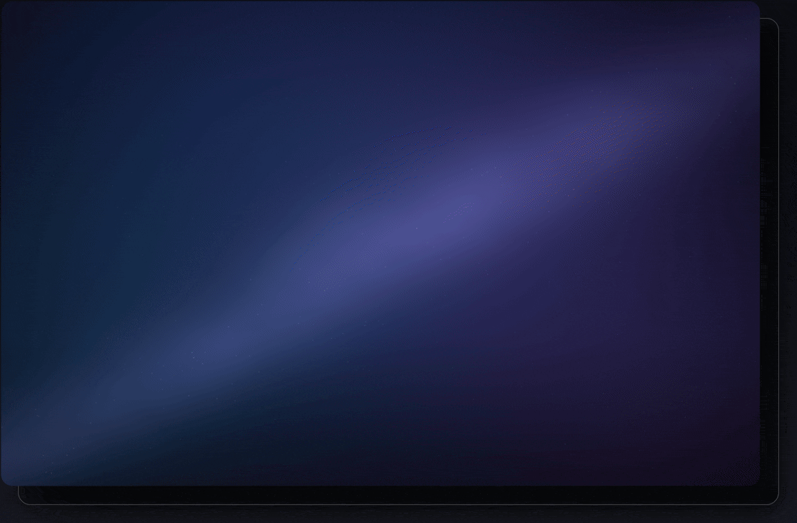
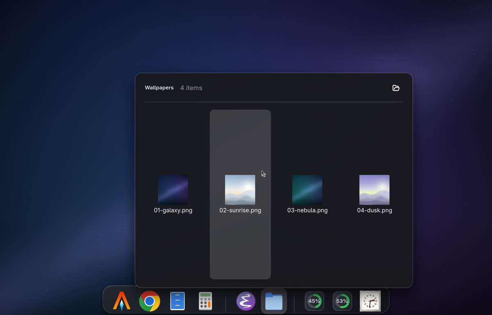
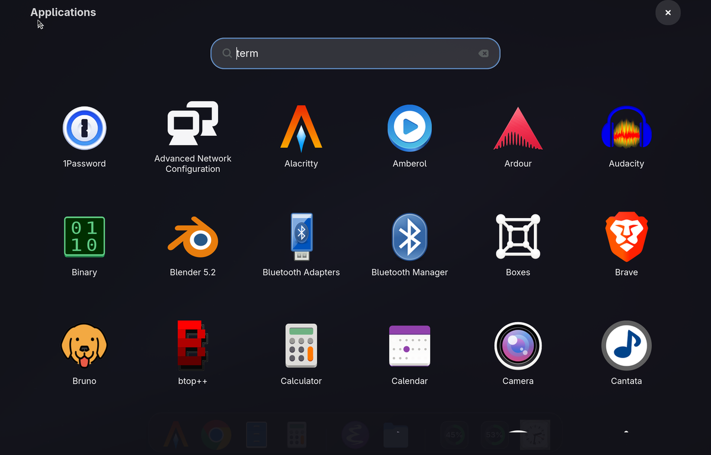
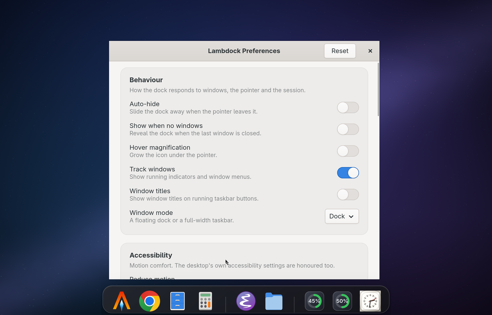
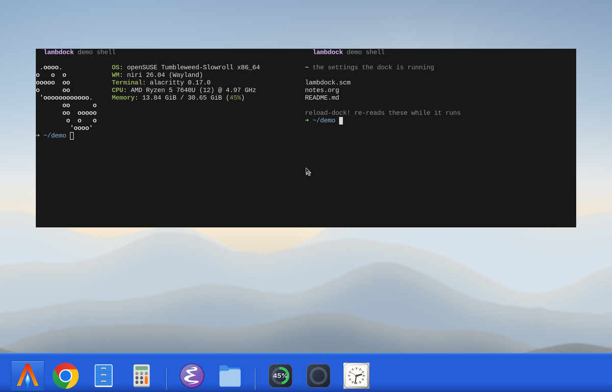

#+title: lambdock
#+subtitle: quest for the eternal dock
#+author: Josep Jesus Bigorra Algaba
#+email: jjbigorra@gmail.com
#+language: en
#+options: toc:nil num:nil html-style:nil
#+HTML_HEAD: <link rel="stylesheet" type="text/css" href="https://jointhefreeworld.org/static/css/jointhefreeworld.css" />

[[https://jointhefreeworld.org/ggg/dist/lang-c.svg]] [[https://jointhefreeworld.org/ggg/dist/gtk4.svg]] [[https://jointhefreeworld.org/ggg/dist/scheme-guile.svg]] [[https://jointhefreeworld.org/ggg/dist/build-meson.svg]] [[https://jointhefreeworld.org/ggg/dist/gnu-guix.svg]] [[https://jointhefreeworld.org/ggg/dist/nix-flake.svg]] [[https://jointhefreeworld.org/ggg/dist/maak.svg]] [[https://jointhefreeworld.org/ggg/dist/i18n-gnu-gettext.svg]]
[[https://img.shields.io/badge/license-MIT-2ea44f.svg]] [[https://jointhefreeworld.org/ggg/dist/jointhefreeworld-org.svg]] [[https://img.shields.io/badge/CI-Byggsteg%20%7C%20Woodpecker-2ea44f.svg]]

/a desktop dock for Wayland that you can reprogram while it is running./

~lambdock~ is a dock for your GNU/Linux desktop: the strip of application
launchers that sits on an edge of the screen, shows which apps are running, and
brings their windows back when you click them.  It is built on *[[https://gtk.org/][GTK4]]* and
*[[https://github.com/wmww/gtk4-layer-shell][gtk4-layer-shell]]*, so it belongs on a *[[https://wayland.freedesktop.org/][Wayland]]* compositor --
[[https://github.com/YaLTeR/niri][Niri]], [[https://swaywm.org/][Sway]], [[https://hyprland.org/][Hyprland]], [[https://github.com/riverwm/river][River]], [[https://kde.org/plasma-desktop/][Plasma]], and friends -- and it is engineered
the way *[[https://www.gnu.org/software/emacs/][Emacs]]* is: a small, fast *[[https://en.wikipedia.org/wiki/C_(programming_language)][C]]* core for rendering, Wayland protocol work and frame-clock animation, wrapped around an
embedded *[[https://www.gnu.org/software/guile/][GNU Guile Scheme]]* engine that is the brain of the whole thing.

That architecture is what makes ~lambdock~ different from every other dock.  You
configure it in *[[https://en.wikipedia.org/wiki/Lisp_(programming_language)][Lisp]]*, theme it in *[[https://developer.mozilla.org/en-US/docs/Web/CSS][CSS]]*, and then you hot-reload both from disk or poke at the running dock
over a *live socket [[https://en.wikipedia.org/wiki/Read%E2%80%93eval%E2%80%93print_loop][REPL]]* -- inspecting state, swapping themes, adding launchers and forcing
a rebuild without ever restarting the process or dropping a frame.

#+name: lambdock-showcase
#+caption: Recorded from a scripted nested niri session by =tools/record-demo/record-demo.sh= (1100 px, 20 fps): auto-hide at the screen edge, the fish-eye under the pointer, launching applications with running indicators, the multi-window popover, the dock's own menu and the Preferences window, a folder stack opened as a grid, the launchpad filtered from the REPL, a live Guile REPL changing the icon size and every theme, and the Windows XP taskbar mode.

- 🐑 *Read the source (and send PR/issue/patches):* [[https://github.com/jjba23/lambdock][github.com/jjba23/lambdock]]
- 📦 *Install it:* [[https://build.opensuse.org/package/show/home:jjba23/lambdock][openSUSE Build Service]], [[https://search.nixos.org/packages?query=lambdock][NixPkgs]], Guix, Docker Hub, and the packaged tarballs
- 📚 *Hack on it:* [[file:HACKING.org][the Developer Onboarding & Architecture Guide]]
- 💬 *Ask anything:* [[https://jointhefreeworld.zulipchat.com/#narrow/channel/632484-lambdock][the lambdock Zulip community]]
- 📰 *Follow what changed:* [[file:NEWS.org][the changelog]]
- 🗺️ *Read why it exists:* [[https://jointhefreeworld.org/blog/articles/gnu-linux/quest-for-eternal-dock/index.html][Quest for the eternal dock]]
- ☕ *Support the work:* [[https://bmc.link/jjbigorra][buying me a cup of coffee]]

#+TOC: headlines 1

------------------

* Features
:PROPERTIES:
:CUSTOM_ID: features
:END:

- *Wayland Native*: Built on GTK4 and ~gtk4-layer-shell~ for smooth edge
  anchoring, cubic-eased slide animations, and compositor integration.
- *Dynamic Window Tracking*: Uses ~zwlr_foreign_toplevel_manager_v1~, the Wayland
  [[https://wayland.app/protocols/wlr-foreign-toplevel-management-unstable-v1][foreign toplevel protocol]],
  to display active app indicators, window titles, and popover
  HUDs for focusing or closing instances; see
  [[#toplevel-tracking][Wayland toplevel tracking]].
- *Multi-Monitor Flexibility*: Span docks across all connected screens
  (~#:monitor 'all~) or lock them to specific output connectors (e.g., ~"DP-1"~);
  see [[#configuration-options][the options reference]].
- *Smooth Auto-Hide*: Keeps the dock out of your way with a two-pixel reveal
  strip and fluid, frame-clock-driven sliding animations.
- *Declarative Lisp Configurations* 🔮: Harness the power of GNU Guile Scheme for
  declarative dock setups, custom app launchers, separators, and options.
  Multiple config files and multiple docks are supported.
- *Smart and Safe Hot-Reloading*: Automatic file watcher
  ([[https://docs.gtk.org/glib/][GLib]] ~GFileMonitor~, with a 150 ms debounce) and
  REPL hook (~reload-dock!~) safely re-evaluate Scheme settings and GTK CSS
  without blocking the UI thread.
- *Live Interactive Socket REPL*: Query state or alter dock parameters live over a
  [[https://en.wikipedia.org/wiki/Unix_domain_socket][Unix domain socket]]
  (=/tmp/lambdock-repl.sock=) via Emacs/Geiser, ~socat~, or ~ncat~; see
  [[#repl][the REPL section]].
- *Theme Engine*: Extensible with CSS, and ships with nineteen built-in themes,
  while supporting user extensions and overrides via
  =~/.config/lambdock/styles.css=; see [[#styling-and-theming][Styling & theming]]
  and the one-line [[#looks][looks]].
- *Flexible Icon Resolution*: Best-effort fallback pipeline resolving GTK theme
  icons, absolute paths, system pixmaps, and symbolic variants.
- *Async Command Launching*: Spawns binaries, scripts, and
  [[https://flatpak.org/][Flatpaks]] asynchronously using GLib process spawning
  without freezing the UI.
- *App Noise Filtering*: Flexible exclusion lists (~#:exclude-apps~) to prevent
  background utilities or specific application IDs from creating unwanted
  launchers.
- *Reproducible Builds*: Fully hermetic development environment and builds
  powered by GNU Guile, Meson, and GNU Guix.
- *Native fluid fish-eye* magnification effect on hover (a la macOS), enabled by
  default and switchable per item or globally if you want less animation.
- *Dock Scrolling*: Seamless mouse wheel scrolling over dock items when the bar
  exceeds available display dimensions.
- *Dynamic Widgets*: RAM, CPU, CPU temperature, battery and clock items, driven by
  Scheme thunks you can replace with your own pollers. The meters are drawn as
  icon-sized gauges that fill up and change colour, and the clock as an analogue
  face -- not as text; see [[#dynamic-widgets][Dynamic widgets]].
- *Stacks* 📁: a dock icon that opens a folder (Downloads, Screenshots, projects)
  as an icon grid or a list; see [[#stacks][Stacks]].
- *Launchpad* 🚀: a full-screen, searchable grid of every installed application,
  parsed from the XDG desktop entries; see [[#launchpad][The launchpad]].
- *Trash* 🗑️: a dock icon that follows the desktop trash -- empty/full artwork and
  an item count, opening it with a click and emptying it from its menu, and taking
  files dropped on it. It reads and writes the freedesktop.org trash layout, not
  one desktop's private store, so it works the same on GNOME, KDE, Xfce, Cinnamon
  and MATE; see [[#trash][The trash]].
- *Drag and drop* 🖱️: reorder icons by dragging them along the dock, drag one out
  to remove it, drop a ~.desktop~ file to add an application or a folder to add a
  stack -- and the layout survives restarts; see
  [[#drag-and-drop][Rearranging the dock]].
- *Keyboard and screen reader friendly* ♿: the whole dock, its menus, stacks and
  the launchpad can be driven from the keyboard (arrows, Home/End, Menu,
  Ctrl+Arrow to rearrange), every icon announces its name and state, focus rings
  are visible, and reduced motion is honoured -- both from the dock's own setting
  and from the desktop's accessibility preferences; see
  [[#accessibility][Keyboard and accessibility]].
- *Nineteen Themes, Two Layout Modes*: from Tiger's Aqua glass and Snow
  Leopard's 3D shelf through Mavericks and Tahoe to the five Windows taskbars
  (XP, Vista, 7, 10, 11), as a
  floating capsule or a full-width taskbar with window titles -- and a
  [[#looks][look]] per theme that sets the whole thing in one line.
- *Free software*: MIT licensed, documentation included.  Yours to run, read,
  fork and extend.

------------------

* What lambdock is
:PROPERTIES:
:CUSTOM_ID: what-lambdock-is
:END:

#+begin_quote
~lambdock~ is a modern, hyper-hackable, Wayland-native desktop dock application
(as made popular by CairoDock, macOS, Plank) engineered for GNU/Linux users,
people that like docks, macOS refugees, ricers, free software and Lisp
enthusiasts, Wayland minimalists...
#+end_quote

It is built in the C programming language using the GTK4 libraries and toolkit,
~gtk4-layer-shell~, and Lisp (GNU Guile Scheme), with full runtime
inspectability and configurability, hot-reload of the config and of the GTK CSS.

Whether you are running Niri, Sway, Hyprland, River, or any ~wlroots~ / Layer
Shell compliant compositor, ~lambdock~ brings clean application launching,
dynamic Wayland foreign-toplevel window tracking, and smooth cubic-eased
auto-hiding directly to your setup.

** Who it is for
:PROPERTIES:
:CUSTOM_ID: who-it-is-for
:END:

- *People who miss the [[https://en.wikipedia.org/wiki/Dock_(macOS)][macOS Dock]]* --
  and want it on a compositor where windows are told who is in charge.  Fish-eye magnification, a glassy capsule, running
  indicators, window titles: all there, none of it proprietary.
- *Wayland minimalists* who keep a compositor, a terminal, and a small pile of
    well-chosen tools -- and want a dock that does not drag an
  [[https://en.wikipedia.org/wiki/X_Window_System][X11]] toolkit, a configuration
  daemon, or a [[https://www.gnome.org/][GNOME]] session along with it.
- *Ricers and theme collectors*, who will want the nineteen built-in themes, the
  CSS override hook, and the ability to restyle anything on the fly.
- *Lisp people*, who would rather write eleven lines of Scheme than file a
  feature request, and who expect a REPL inside the program they are running.
- *Free software lovers* who want the dock to be theirs: MIT licensed,
  no account, no telemetry, no phone-home.

** What it is built with
:PROPERTIES:
:CUSTOM_ID: what-it-is-built-with
:END:

~lambdock~ is powered by:
*[[https://en.wikipedia.org/wiki/C_(programming_language)][C]]* and *GTK4* /
*[[https://docs.gtk.org/gsk4/][GSK]]* for the graphics core and the
frame-clock-driven animations,
*[[https://github.com/wmww/gtk4-layer-shell][gtk4-layer-shell]]* for the Wayland
surface protocol,
*[[https://www.gnu.org/software/guile/][GNU Guile 3.0]]* embedded in-process through
[[https://www.gnu.org/software/guile/manual/html_node/libguile.html][libguile]],
*[[https://mesonbuild.com/][Meson]]* and *[[https://ninja-build.org/][Ninja]]* for
the build, *[[https://guix.gnu.org/][GNU Guix]]* and
*[[https://nixos.org/][Nix]]* for hermetic, reproducible environments,
*[[https://codeberg.org/jjba23/maak][Maak]]* for the task runner,
*[[https://www.gnu.org/software/gettext/][GNU gettext]]* for translations, and
[[https://www.gnu.org/software/emacs/][Emacs]] (with
[[https://www.nongnu.org/geiser/][Geiser]]) as the recommended way to talk to the
running dock.

There is no scripting bridge to a separate process, no
[[https://en.wikipedia.org/wiki/D-Bus][D-Bus]] daemon in the middle, and no
configuration format to learn in [[https://www.json.org/][JSON]] or
[[https://yaml.org/][YAML]]: the interpreter is inside the dock, and the dock is the
interpreter's playground.

** Glossary: the words in this document
:PROPERTIES:
:CUSTOM_ID: glossary
:END:

New to the Wayland, GTK or Lisp stack?  Every piece of jargon in this document is
one line away.  Skim it now, or come back when a word bites.

| Term                    | What it means                                                                                                                                                     |
|-------------------------+-------------------------------------------------------------------------------------------------------------------------------------------------------------------|
| *Wayland*               | The modern display protocol on GNU/Linux.  [[https://wayland.freedesktop.org/][wayland.freedesktop.org]]                                                         |
| *Compositor*            | The Wayland program that draws windows, positions surfaces and routes input: Niri, Sway, Hyprland, River, Plasma, ...                                             |
| *Layer shell*           | The Wayland protocol for surfaces that belong to the desktop rather than to a window (bars, docks, launchers).  Provided by [[https://github.com/wmww/gtk4-layer-shell][gtk4-layer-shell]].                      |
| *GTK 4*                 | The graphical toolkit ~lambdock~ draws with.  [[https://gtk.org/][gtk.org]]                                                                                       |
| *GSK*                   | The GTK Scene Kit, GTK4's rendering engine.  [[https://docs.gtk.org/gsk4/][docs.gtk.org/gsk4]]                                                                  |
| *GLib / GIO*            | The C utility and I/O library under GTK (file monitors, idle dispatch, process spawning).  [[https://docs.gtk.org/glib/][docs.gtk.org/glib]]                                     |
| *Guile*                 | GNU's implementation of Scheme, and the extension language embedded in ~lambdock~.  [[https://www.gnu.org/software/guile/][gnu.org/software/guile]]                                       |
| *Lisp / Scheme*         | The functional language family this dock is configured in.  [[https://en.wikipedia.org/wiki/Lisp_(programming_language)][Wikipedia]]                                           |
| *S-expression*          | The fully parenthesized syntax of Lisp, which is also the data it manipulates.  [[https://en.wikipedia.org/wiki/S-expression][Wikipedia]]                                   |
| *Thunk*                 | A procedure that takes no arguments; here, what a dynamic widget polls for its text.                                                                             |
| *REPL*                  | Read-Eval-Print Loop: a live prompt where you type code and see the result at once.  [[https://en.wikipedia.org/wiki/Read%E2%80%93eval%E2%80%93print_loop][Wikipedia]]                 |
| *Quasiquoting, macros*  | Lisp facilities for writing code that writes code.                                                                                                               |
| *Foreign toplevel*      | The Wayland protocol that tells a client what windows exist and what they are called.  [[https://wayland.app/protocols/wlr-foreign-toplevel-management-unstable-v1][protocol reference]]                  |
| *Popover*               | A small floating menu anchored to a widget: here, the window HUD.                                                                                                |
| *XDG*                   | The freedesktop.org conventions for where desktop programs keep their files.  [[https://specifications.freedesktop.org/basedir-spec/basedir-spec-latest.html][base directory specification]]              |
| */proc*                 | The pseudo-filesystem where the Linux kernel reports memory, CPU, temperature and battery state.  [[https://en.wikipedia.org/wiki/Procfs][procfs]]                                   |
| *gettext, .po*          | GNU's translation system, and the per-language files it reads.  [[https://www.gnu.org/software/gettext/][gnu.org/software/gettext]]                                           |
| *Meson, Ninja*          | The build system and the build runner.  [[https://mesonbuild.com/][mesonbuild.com]], [[https://ninja-build.org/][ninja-build.org]]                                                            |
| *Guix, Nix*             | Functional package managers that pin every dependency, including the compiler.  [[https://guix.gnu.org/][guix.gnu.org]], [[https://nixos.org/][nixos.org]]                              |
| *Flatpak*               | A sandboxed application packaging format; the ~-flatpak~ presets launch apps through it.  [[https://flatpak.org/][flatpak.org]]                                               |
| *Maak*                  | The Scheme task runner this project builds with instead of a Makefile.  [[https://codeberg.org/jjba23/maak][codeberg.org/jjba23/maak]]                                          |
| *socat, ncat, rlwrap*   | Terminal tools for talking to the socket REPL, the last one adding line editing.                                                                                 |
| *ccls, LSP*             | A C/C++ language server, and the Language Server Protocol editors speak:  [[https://github.com/MaskRay/ccls][ccls]], [[https://microsoft.github.io/language-server-protocol/][LSP]]                                                 |

** Where to start
:PROPERTIES:
:CUSTOM_ID: where-to-start
:END:

|----------------------------------+-----------------------------------------------------------------------|
| *Just want to see it?*           | Watch the GIF above, read [[#features][Features]], then [[#quick-start][Quick start]].                       |
| *New to all of this?*            | Start with the [[#glossary][glossary]], then [[#which-compositors-are-supported][which compositors are supported]].                       |
| *Want it on your desktop now?*   | [[#quick-start][Quick start]] gets a themed dock on screen in under a minute.  |
| *Want to install it properly?*   | [[#installing-lambdock][Installing lambdock]] has Guix, Nix, Meson, distro and container paths. |
| *Want to hack on it?*            | Read [[file:HACKING.org][HACKING.org]], then [[#developing][Developing lambdock]].                        |
|----------------------------------+-----------------------------------------------------------------------|

** Which compositors are supported
:PROPERTIES:
:CUSTOM_ID: which-compositors-are-supported
:END:

~lambdock~ is a GNU/Linux first utility.  It uses ~gtk4-layer-shell~ to render,
position itself, and behave like a dock.  That means it works well in Wayland
compositors that implement the ~wlr-layer-shell-unstable-v1~ protocol, including:

- *Smithay-based compositors*: Niri, [[https://system76.com/cosmic][COSMIC Desktop]]
- *wlroots-based compositors*: [[https://gitlab.freedesktop.org/wlroots/wlroots][wlroots]]
  powers Sway, Hyprland, River, [[https://wayfire.org/][Wayfire]]
- *KDE Plasma* (Wayland session)
- *[[https://mir-server.io/][Mir]]-based compositors*

Note: [[https://en.wikipedia.org/wiki/Mutter_(software)][GNOME (Mutter)]] is
currently not supported, because it does not implement the protocol.

What happens on a compositor *without* layer shell (GNOME, or an X11 session) is
defined, not undefined: ~lambdock~ says so once in the log and then runs as an
ordinary window -- no screen-edge docking, no auto-hide and no exclusive zone,
because those are layer-shell features.  Window tracking is independent of it:
where the compositor implements ~wlr-foreign-toplevel~ (Niri, Sway, Hyprland,
Plasma, ...) running applications and their window menus work; where it does not
(GNOME), the log says that too and the dock keeps its pinned items.

** Why it exists (a note from the author)
:PROPERTIES:
:CUSTOM_ID: why-it-exists
:END:

On the 30th of July 2026, I had a revelation and set out to build ~lambdock~: a
Wayland-native desktop dock that wouldn't just replicate the macOS or Cairo-Dock
experience, but would transcend it with full runtime inspectability, hackability,
and Lisp enlightenment.

I find GTK to be the very best UI toolkit for GNU/Linux and other platforms,
anno 2026. So for me that choice was pretty clear, even if I also toyed with Qt
and others, but GTK always came on top. After the wreckage of many PoCs and while
reading some HackerNews in bed, a thought crossed my mind, and suddenly,
*absolute clarity*!

Why not use idiomatic modern GTK4, in the language that it's written in. Oh wait,
that language, C, has ~libguile.h~, a great library inter-operability with Lisp
(GNU Guile Scheme), allowing bi-directional bindings and communication. Why not
go down this rabbit hole, which might at the same time teach me more about my
favourite language (GNU Guile) and allow me a frictionless setup with GTK and
native super performance.

#+BEGIN_EXPORT html

#+END_EXPORT

#+begin_quote
I therefore designed lambdock in my mind, in bed, much inspired by Emacs. A
powerful, small C core that powers the program, rendering, graphics and low level
details, and an embedded GNU Guile Scheme engine that at runtime is the heart and
brain of the whole thing. This architecture uniquely delivers interactive socket
REPL control, Lisp metaprogramming macros, dynamic multi-dock spawning, native
Wayland foreign-toplevel window tracking, and frame-clock-driven hover
animations.
#+end_quote

#+begin_quote
~lambdock~ is a story of resilience in many ways, as I cannot even remember how
many attempts I made at building a dock (in different ways). Little did I know
how many paradigms, ideas and PoCs would collapse before my vision became
tangible reality.
#+end_quote

------------------

** Demo recording
:PROPERTIES:
:CUSTOM_ID: demo-recording
:END:

Recording and encoding are separate programs, so the look of the thing can be
iterated without touching the compositor:

#+begin_src sh
./tools/record-demo/encode-demo.sh --raw raw.mkv --events events.tsv --out demo.gif
#+end_src

The storyboard runs twelve scenes: a title card, auto-hide at the screen edge,
fish-eye magnification, launching with running indicators, the window popover,
the dock's own menu and the Preferences window, a folder stack opened as a grid,
the launchpad filtered from the REPL, a live Guile REPL session (icon size, then
eleven built-in themes), the Windows XP taskbar mode, and a
closing card.  Each scene is checked frame by frame against its caption before a
recording is published.  See [[file:tools/record-demo/README.org][tools/record-demo/README.org]] for prerequisites
and options.

Four stills from the same recording, for a closer look:

|       |  |
|  |    |

* Using the dock
:PROPERTIES:
:CUSTOM_ID: using-the-dock
:END:

A dock is a mouse-first object, so here is everything it can do once it is on
your screen.

** Launching, focusing and switching
:PROPERTIES:
:CUSTOM_ID: launching-focusing-and-switching
:END:

- *Left click a pinned launcher*: the app starts.  If the app is already running,
  its window is focused and raised instead of a second instance being spawned.
- *Left click a running app with one window*: the window is focused -- or
  *minimized*, if it already had the focus.  That is the "minimize to dock"
  behaviour: clicking the icon of the app you are looking at tucks it away, and
  clicking again brings it back.  While it is tucked away the icon keeps its
  running indicator but dims, so you can see at a glance which apps are only
  minimized.  It uses the compositor's ~wlr-foreign-toplevel~ minimize request, so
  it works on compositors that have a minimize concept (sway, Hyprland, KWin,
  ...); on a scrollable tiling compositor such as niri, where windows are always
  visible, the request is accepted and the window simply stays where it is.
- *Left click a running app with several windows*: the window popover opens (see
  below), so you pick which window you meant.
- *Right click a running app with several windows*: the same popover, useful when
  you want to close one instance without stealing focus.

** The window popover (HUD)
:PROPERTIES:
:CUSTOM_ID: the-window-popover
:END:

When an app has one window, clicking it focuses it -- or minimizes it when it is
the window you are already looking at (see
[[#launching-focusing-and-switching][Launching, focusing and switching]]).  When it
has more than one, ~lambdock~ opens a floating GTK popover built from what the
compositor told it:

- a *header* with the application's name, then a separator;
- *one row per open window*, with a dot marking the window that holds the focus,
  the window title as a button (ellipsized at 30 characters) to focus that
  instance, and a close button next to it.  A window the compositor reported as
  minimized is dimmed, and the close button stays quiet until the row is under
  the pointer or the keyboard is on it, so a list of titles does not look like a
  list of crosses;
- *New Instance*, to start another instance of the application, when the item has
  an exec command;
- *Close All Windows*, shown only when more than one window is open;
- *Launch Application*, when an app is in the dock but nothing is running yet.

Every entry carries a symbolic icon -- a window for a new instance, an eye with
a slash for a private window, a play triangle or a skip arrow for the playback
controls, a bin for a removal -- so a menu of five kinds of entry can be
scanned.  The icon-only buttons are named after what they act on, so a screen
reader says "Close window, editor — main.c" rather than just "button".  The menu
is a keyboard object in its own right: it opens with the
focus on its first row, *Up*/*Down* walk the rows, *Home*/*End* jump to the ends,
and *Escape* closes it.  Right-clicking the dock icon and clicking its menu are
the same menu.

The protocol behind that list is described in
[[#toplevel-tracking][Wayland Toplevel Tracking & Popovers]].

** The dock's own menu
:PROPERTIES:
:CUSTOM_ID: the-docks-own-menu
:END:

Right-clicking the dock background opens a small menu with *Preferences…*
(the GUI settings window, see [[#preferences-window][the preferences window]]),
*About lambdock* (the splash dialog with version, licence and a link to the
source) and *Quit*.

** Scrolling a crowded dock
:PROPERTIES:
:CUSTOM_ID: scrolling-a-crowded-dock
:END:

When the launchers, running apps and widgets no longer fit on screen, the items
are packed into an overflow-visible
[[https://docs.gtk.org/gtk4/class.ScrolledWindow.html][scrolled viewport]]
(~GtkScrolledWindow~).  Mouse wheel and touchpad scrolls translate directly into
movement along the dock's axis, horizontally or vertically.

** Auto-hide
:PROPERTIES:
:CUSTOM_ID: auto-hide
:END:

With ~dock-auto-hide?~ enabled, the dock slides off the screen edge with a
250 ms cubic ease-out transition and comes back when the pointer reaches a
two-pixel strip at that edge.  It waits a moment before hiding again (400 ms
after a popover closes, 600 ms after the pointer leaves) so that a hasty
mouse movement does not chase the dock away.  The hide/show is driven by
=gtk_widget_add_tick_callback=, so it stays in step with your display's refresh
rate, 60 Hz or 120 Hz or whatever your compositor gives it.

Parking the pointer on that edge keeps the dock out, and leaving does not need any
particular gesture: the strip is the last two pixels of the screen, so a pointer
resting there is on the dock when it is in and a hair past it when it is out. The
dock ignores the crossings its own slide produces -- a window that moves under a
still pointer makes a compositor report the pointer leaving a surface it is still
on -- and a leave only counts once the pointer has actually moved since it
arrived. That is what used to make it bounce in and out for as long as the pointer
stayed put.

** Stacks: a folder on the dock 📁
:PROPERTIES:
:CUSTOM_ID: stacks
:END:

A *stack* is a dock icon that opens the contents of a directory -- the macOS
Downloads stack, except that you decide which folder it shows.  Add one with
~stack-item~:

#+begin_src scheme
(define dock-items
  (list (stack-item #:name "Downloads"   ; what the header and tooltip say
                    #:path "~/Downloads" ; the folder to show ("~" is expanded)
                    #:view-mode 'grid)   ; 'grid or 'list
        (stack-item #:name "Screenshots"
                    #:path "~/Pictures/Screenshots"
                    #:icon "folder-pictures"
                    #:view-mode 'list)))
#+end_src

| Keyword        | Default    | What it does                                        |
|----------------+------------+-----------------------------------------------------|
| ~#:name~       | ~"Stack"~  | Header of the popover and the tooltip.              |
| ~#:path~       | ~""~       | Folder to list. A leading ~/~ is expanded to ~$HOME~. |
| ~#:icon~       | ~"folder"~ | The icon of the dock item itself.                   |
| ~#:view-mode~  | ~'grid~    | How the popover lays out the contents.              |

Clicking the icon opens a popover with the folder's contents (hidden dot-files
are skipped, folders come first, then names; at most 300 entries are listed so a
gigantic directory cannot lock the UI up):

- *grid*: a flow box of tiles, four to seven per row, the default;
- *list*: one row per entry with its content-type icon, close to a file
  manager's list view.

In every view, an image file shows a live, centre-cropped thumbnail of its
contents instead of a generic type icon.  Thumbnails are decoded in the
background, one at a time, so opening a folder of large photos does not stall
the dock; closing the popover stops the remaining work.

*** The panel is a small file browser

The header carries where you are, how much is there, and three controls:

- *Back* (only while you are inside a subfolder): walks up one folder *inside the
  panel*;
- the *view toggle*: flips between the grid and the list, and remembers the
  choice for that stack (the same setting as ~(stack-item #:view-mode ...)~);
- *Open folder*: hands the folder you are looking at to your file manager.

The title is a breadcrumb -- "Downloads", then "Downloads / Shots / 2024" -- and
the count turns into "300+ items" plus a line saying that only the first entries
are shown when a folder is bigger than the panel is willing to list.

*Clicking a folder walks into it; clicking a file opens it and dismisses the
panel.*  It used to be that every entry went to the desktop, which made the
panel a printout of one folder rather than a way to look around: the file
manager is now one button away, and browsing does not leave it open underneath.

Empty folders are not an error: the panel says "This folder is empty".

Right-clicking the stack on the dock still switches the view mode or opens the
folder, for when the panel is not open.

The keyboard works without the mouse: *Down* from the searchless panel lands on
the first entry, the arrows move by tile (a whole row at a time in the grid
view), *Home*/*End* jump to the ends, *Enter* opens, and *Escape* closes the
panel (the back button is one *Tab* away from the entries).

** The launchpad 🚀
:PROPERTIES:
:CUSTOM_ID: launchpad
:END:

One item puts every installed application one click (and half a keystroke) away:

#+begin_src scheme
(define dock-items
  (list (launchpad-item)                          ; name: "Launchpad"
        (launchpad-item #:name "Apps"             ; or your own label
                        #:icon "view-app-grid-symbolic")))
#+end_src

Clicking it covers the screen with a layer-shell overlay: a search field, and
below it every application found in the XDG application directories, sorted by
name and shown as icon tiles.  There is no title: the grid of everything
installed is the screen, and the search field says what it searches.  What the
header carries is one close button, and it sits on the *left* by default, where a
window's own controls are (a setting moves it to the right for people who prefer
that).  The search field has the keyboard the moment the launchpad opens, so you
can just start typing.  Type to filter (the name and the command line are both
searched), press *Enter* on a result... nothing else: click a tile to launch it,
press *Escape*, click the close button or click the backdrop to go back to
whatever you were doing.

Its appearance follows the settings of the dock that opened it:

| Option                       | Default | What it does                                             |
|------------------------------+---------+-----------------------------------------------------------|
| ~dock-launchpad-icon-size~   | ~80~    | Pixel size of an application icon in the grid (32 … 160). |
| ~dock-launchpad-columns~     | ~0~     | Tiles per row. 0 fits as many as the screen allows; 3 … 14 is an upper bound (the grid still shrinks to fit). |
| ~dock-launchpad-blur?~       | ~#f~    | Frosted, translucent background instead of the near-opaque one. |
| ~dock-launchpad-close-side~  | ~'left~ | Which end of the header the close button sits on: ~'left~ or ~'right~. |

#+begin_src scheme
(define dock-launchpad-icon-size 80)
(define dock-launchpad-columns 6)
(define dock-launchpad-blur? #t)
(define dock-launchpad-close-side 'right)   ; default is 'left
#+end_src

A real blur of what is *behind* the launchpad is the compositor's job, and
almost every Wayland compositor can do it for translucent layer surfaces.  KWin
blurs them by default.  On niri, add a layer rule matching the launchpad's
namespace:

#+begin_src kdl
layer-rule {
  match namespace="^lambdock-launchpad$"
  background-effect {
    blur true
  }
}
#+end_src

Without such a rule the option still gives a darker, tinted glass backdrop, just
not a blurred one: the tint is deliberately dense (18, 18, 24 at 82% in frosted
mode, 94% in the solid one) so that labels keep their contrast over a bright or
busy desktop, whether or not the compositor blurs what is behind.

An application that is installed twice -- the distro package *and* its Flatpak
export, say -- has one tile showing that fact in its tooltip, and its context
menu (right click, *Menu* or *Shift+F10*) lists the copies, each with where it
comes from and the command it runs, so clicking the tile starts the copy the
scan preferred while the menu starts the one you pick.  Applications installed
once have no menu, and a right click on them does nothing.

Under the hood it parses the ~.desktop~ entries with ~GKeyFile~ (locale aware
~Name~, ~Exec~ with the ~%f~ / ~%U~ / ~%i~ field codes stripped, ~Icon~), skips
what the user or the distribution hid (~Hidden=true~, ~NoDisplay=true~) and
deduplicates by desktop file name, so a Flatpak export overrides the identical
system entry.  An application installed twice under two different file names (a
distro package and its Flatpak export: ~libreoffice-writer.desktop~ and
~org.libreoffice.LibreOffice.writer.desktop~) is collapsed into a single tile as
well: two entries are the same application when they share a name and the window
class they declare, or the icon when neither declares a class.  The copy that
stays on the grid is the first one the scan reaches (your own directory, then
Flatpak, then the system) and it carries the others as its alternatives, which
is what the tile's menu offers.  Applications that merely share a name, like two
different panels called *Displays*, are still listed separately.  The list is
rescanned every time the launchpad opens, so an app you just installed is there
without restarting the dock.

** The trash 🗑️
:PROPERTIES:
:CUSTOM_ID: trash
:END:

One item puts the desktop trash on the dock:

#+begin_src scheme
(define dock-items
  (list (trash-item)                        ; name: "Trash"
        (trash-item #:name "Bin"            ; or your own label
                    #:icon "user-trash-symbolic")))
#+end_src

| Keyword             | Default          | What it does                                   |
|---------------------+------------------+------------------------------------------------|
| ~#:name~            | ~"Trash"~        | Header, tooltip and menu title.                |
| ~#:icon~            | ~"user-trash"~   | Artwork shown while the trash is empty.        |
| ~#:hover-animate?~  | ~#t~             | Whether the fisheye magnification applies.     |

The icon follows the trash: the configured icon while it is empty, and the icon
theme's ~user-trash-full~ (or ~user-trash-full-symbolic~, when the configured
icon is a symbolic one) once it holds anything, with the number of items in the
tooltip.  A custom theme icon used as ~#:icon~ is the empty-state artwork, and
the full state swaps in the theme's full icon; an icon given as a file or
resource is kept as it is in both states (the tooltip still counts the items).
The item re-counts every two seconds, so a file deleted from any other program
shows up without restarting the dock.

- *Left click* opens the trash in your file manager: ~trash:///~ when your desktop
  provides a handler for it, then the folder-handling file manager with that URI
  (the usual case, because most distributions never register an
  ~x-scheme-handler/trash~), then the home trash folder as a last resort.
- *Right click* shows how many items are in the trash, with *Open Trash* and
  *Empty Trash* (disabled when there is nothing to empty).
- *Drop files or folders on it* moves them to the trash.  Folders go with
  everything inside them, and a name that is already taken in the trash gets a
  fresh one instead of overwriting anything.

None of this is specific to one desktop.  The item reads and writes the trash the
way the [[https://specifications.freedesktop.org/trash-spec/latest/][freedesktop.org
Trash specification]] defines it: the home trash lives in
=$XDG_DATA_HOME/Trash= (normally =~/.local/share/Trash=), and every mounted
volume can have its own under =$topdir/.Trash/$uid= or =$topdir/.Trash-$uid=.
The count and the empty action cover all of them, with no ~gio~ command, GVfs or
GNOME/KDE helper involved, which is what makes the icon behave the same across
GNOME, KDE, Xfce, Cinnamon, MATE and the rest.  Dropped files are handed to
GIO's ~g_file_trash()~ -- the library call, not a desktop service -- which
implements that same specification: it picks the right volume's trash, writes
the =*.trashinfo= entry and resolves name collisions.  Emptying and dropping both
run off the main loop, so a trash with thousands of files does not freeze the
dock while it is cleared or filled.

** Rearranging the dock with drag and drop 🖱️
:PROPERTIES:
:CUSTOM_ID: drag-and-drop
:END:

The dock is not a fixed row of icons: it is something you arrange.

- *Reorder*: drag any icon along the dock and drop it where you want it.  The
  item is inserted on the side of the icon you dropped over.
- *Remove*: drag an icon *out* of the dock and let go anywhere that is not the
  dock (the desktop, a window, empty space).  The icon goes away; nothing is
  uninstalled, the app just leaves the dock.
- *Add an application*: drag a ~.desktop~ file from your file manager onto the
  dock and it becomes a launcher, using the entry's own name, icon and command.
- *Add a stack*: drag a *folder* onto the dock and it becomes a stack showing that
  folder.

There are also two menu items for the impatient: right-click any item and pick
*Remove from Dock*, and right-click a stack to change its view mode.

Where do the changes go?  Your settings file stays the source of truth, so
drag-and-drop writes a small override file next to the dock's state instead of
rewriting (or fighting with) a configuration that other tools may generate. The
Preferences window's *Add an item* row (see
[[#preferences-window][the preferences window]]) appends its widgets to the same
file:

#+begin_src scheme
;; ~/.local/state/lambdock/layout-settings.scm  (or $XDG_STATE_HOME/lambdock/)
;; Written automatically by drag and drop in the dock, and by the
;; Preferences window's "Add an item" row.
;; Delete this file to go back to the items in your settings file.
((order "app:Firefox" "app:Terminal" "stack:Downloads")
 (removed "app:Files")
 (added ("app" "Slack" "slack" "slack --start" "")
        ("stack" "Shots" "folder" "/home/you/Pictures/Shots" "grid"))
 (views ("stack:Downloads" . list)))
#+end_src

It records four independent things: the item *order*, the items you dragged
*out*, the items you dragged *in*, and per-stack *view modes*.  On the next start
they are replayed on top of whatever the settings file says, so regenerating your
configuration keeps working: new items appear, the ones you removed stay removed,
and the stack you switched to a list stays a list.  Delete the file (or call
~(dock-layout-reset! path)~ from the REPL) to go back to the pure configuration.

Item identity is =kind:name= (the Scheme procedure ~dock-item-key~), which is why
the file is readable and why two items with the same name and kind are treated as
the same item.  Separators have no stable name, so they are not listed at all:
they keep their place between their neighbours.

** Keyboard and accessibility ♿
:PROPERTIES:
:CUSTOM_ID: accessibility
:END:

A dock is easy to think of as a mouse-first object.  It does not have to be: every
pointer action on the dock has a keyboard equivalent, and every icon says out loud
what it is.

*** Keyboard

- *Tab* moves the focus into the dock.  The dock is a layer-shell surface, so it
  asks the compositor for the keyboard on demand; clicking the dock, or a
  compositor shortcut that focuses layer surfaces, hands it over.
- *Left/Right* walk the icons on a horizontal dock, *Up/Down* on a side dock.
  *Home* and *End* jump to the first and last icon.
- *Enter* or *Space* activates the focused icon, exactly like a click: it starts
  the application, focuses its window, opens the stack, the launchpad or the trash.
- *Menu* or *Shift+F10* opens the focused icon's context menu: the keyboard's
  right click.
- *Ctrl+Left/Right* (Ctrl+Up/Down on a side dock) moves the focused icon along the
  dock, so rearranging it does not require a drag.  The new order is stored in the
  same layout override file drag and drop writes.
- *Escape* closes whatever the dock has open: a context menu, a stack popover or
  the launchpad.
- In the launchpad, typing goes to the search field, *Down* enters the grid, the
  arrows move by tile, and *Enter* launches.  *Return* in the search field launches
  the first match.  On a tile of an application installed more than once, *Menu*
  or *Shift+F10* opens the menu of its copies.
- In a stack, the arrows move between entries (a whole row at a time in the grid
  view) and *Enter* opens the entry; *Home*/*End* jump to the first and last one.
- The preferences window closes with *Escape*, and every slider has a spin button
  next to it for typing an exact value.

*** Screen readers

Every dock icon has an accessible name and description, refreshed whenever that
state changes:

- "Terminal, Running, 2 windows" -- or "Not running";
- "Projects, folder stack" for a stack;
- "Trash, 3 items in the trash" for the trash;
- "Clock: 14:05" for a dynamic item or a meter reading.

Launchpad tiles ("Firefox. Application. Press Enter to open."), stack entries
("report.pdf. File.") and every preference control ("Reduce motion", "Icon size")
are labelled too.  When the focus moves to a control, a screen reader reads it, and
changes that have no focus move of their own are announced (on GTK 4.14 and newer,
which is where announcements appeared).

Keyboard focus is drawn as a visible ring on dock icons, launchpad tiles, stack
entries and preference controls, and only for keyboard focus (~:focus-visible~),
so a mouse click keeps the untouched look.

*** Reduced motion

~dock-reduce-motion?~ (Preferences → *Accessibility* → *Reduce motion*) turns off
the dock's slide animation and its fish-eye magnification.  The dock still gets out
of the way and still responds to the pointer, it just does it in one step instead
of animating.  Turning animations off in the desktop's own accessibility settings
has the same effect -- ~lambdock~ watches the toolkit's ~gtk-enable-animations~
setting, so a change there applies to the running dock immediately, not at the
next start.

#+begin_src scheme
(define dock-reduce-motion? #t)
#+end_src

------------------

* Quick start (the impatient path)
:PROPERTIES:
:CUSTOM_ID: quick-start
:END:

You need [[https://guix.gnu.org/][GNU Guix]] for this path (the other paths are in
[[#installing-lambdock][Installing lambdock]]) and a running layer-shell compositor.

#+begin_src sh
# 1. Get the source
git clone https://github.com/jjba23/lambdock.git
cd lambdock

# 2. Write a settings file
mkdir -p ~/.config/lambdock
cat > ~/.config/lambdock/settings.scm <<'EOF'
(define dock-position 'bottom)
(define dock-theme 'vanilla)
(define dock-auto-hide? #t)
(define dock-icon-size 48)

;; Gap between dock items, in px. 4 is the OS X dock's (its icons are about
;; 0.3 icons apart); the theme's own button padding/margins add to it.
(define dock-item-spacing 4)
(define dock-items
  (append (preset-launchers-for 'alacritty 'firefox 'emacs)
          (list (separator-item))
          (preset-launchers-for 'ram 'cpu 'clock)))
EOF

# 3. Run it, with every dependency pinned
guix time-machine --channels=channels.scm -- shell -f guix.scm -- lambdock
#+end_src

A themed dock should now be at the bottom of your screen with a few launchers
and three live widgets.  Leave it running, edit =~/.config/lambdock/settings.scm=
in your editor, and save: the dock rebuilds itself where it stands.  Swap
~'vanilla~ for ~'snow-leopard~ or ~'windows-xp~ and save again to see the theme
change.

For a whole desktop in one line, replace those sizes and numbers with a
[[#looks][look]]: ~(define dock-look 'osx-mavericks)~ brings the theme, the icon
size, the spacing and the glass-shelf geometry together, and
~(define dock-look 'osx-tiger)~, ~'osx-tahoe-dark~ or ~'windows-xp~ are one word
away.

To get a dock on every monitor, set ~(define dock-monitor 'all)~.  To turn the
dock into a full-width taskbar with window titles, set
~(define dock-mode 'taskbar)~ and ~(define dock-show-window-titles? #t)~.

------------------

* Installing lambdock
:PROPERTIES:
:CUSTOM_ID: installing-lambdock
:END:

** Dependencies
:PROPERTIES:
:CUSTOM_ID: dependencies
:END:

The project requires the following C and Scheme dependencies:

- *GTK 4* (~gtk4~)
- *GTK4 Layer Shell* (~gtk4-layer-shell~)
- *GNU Guile 3.0* (~guile-3.0~)
- *Wayland development files* (~libwayland-dev~, ~wayland-protocols~,
  ~wlr-protocols~)
- [[https://mesonbuild.com/][Meson]] & [[https://ninja-build.org/][Ninja]], and
  [[https://en.wikipedia.org/wiki/Pkg-config][pkg-config]]
- [[https://www.gnu.org/software/gettext/][GNU gettext]] (for building the
  translations)

** GNU Guix
:PROPERTIES:
:CUSTOM_ID: gnu-guix
:END:

~lambdock~ is officially distributed via the
[[https://guix.gnu.org/][Guix]] package manager. You can also use Guix locally and
to develop on this project. See also the ~run~ maak task.

Enter a development container with all required dependencies:

#+begin_src sh
guix time-machine --channels=channels.scm -- shell -m manifest.scm
#+end_src

Also, a ~guix.scm~ is provided to run lambdock fully with Guix.

#+begin_src sh
guix time-machine --channels=channels.scm -- shell -f guix.scm -- lambdock
#+end_src

-------

** Nix
:PROPERTIES:
:CUSTOM_ID: nix
:END:

~lambdock~ is officially part of [[https://search.nixos.org/packages][NixPkgs]], and
can also easily be used with [[https://nixos.org/][Nix]] (flakes) too, where
[[https://github.com/NixOS/nixpkgs][nixpkgs]] supplies the packages. See also the
~nix-build~ maak task.

#+begin_src shell
nix --extra-experimental-features 'nix-command flakes' build
nix --extra-experimental-features 'nix-command flakes' run .#
#+end_src

-------

** Meson
:PROPERTIES:
:CUSTOM_ID: meson
:END:

The plain path, with [[https://mesonbuild.com/][Meson]] and
[[https://ninja-build.org/][Ninja]] from your own distribution:

#+begin_src sh
# Setup build directory
meson setup build

# Compile project
meson compile -C build

# Run locally
./build/lambdock
#+end_src

-------

** Arch Linux
:PROPERTIES:
:CUSTOM_ID: arch-linux
:END:

On [[https://archlinux.org/][Arch Linux]], ensure the dev build tools are installed:
=sudo pacman -S --needed base-devel=

Then go to ~packaging/arch~ and run ~makepkg -sic~ to install lambdock.
See also the ~arch-build~ maak task.

-------

** openSUSE (RPM distros)
:PROPERTIES:
:CUSTOM_ID: opensuse
:END:

~lambdock~ is packaged on [[https://www.opensuse.org/][openSUSE]]'s
[[https://build.opensuse.org/package/show/home:jjba23/lambdock][OBS]] and you can
download it from there, or add the Zypper repo.  The packages it produces are
[[https://en.wikipedia.org/wiki/RPM_Package_Manager][RPMs]], which also fit Fedora
and RHEL.

To build the RPM locally on Tumbleweed, install the packaging tools and setup the
developer directories. See also the ~rpm-build~ maak task.

#+begin_src shell
sudo zypper install rpm-build  rpmdevtools  osc  rpmlint
rpmdev-setuptree
#+end_src

Create the source tarball. You can do this with ~git archive~ (or also simply
copying the directory and manually ~tar -cvzf~). This tarball should be placed in
=~/rpmbuild/SOURCES/=

Copy the spec and build the RPM:
#+begin_src shell
cp packaging/opensuse/lambdock.spec ~/rpmbuild/SPECS/
rpmbuild -ba ~/rpmbuild/SPECS/lambdock.spec
#+end_src

Then you should get the RPM files successfully generated:
#+begin_src shell
~/rpmbuild/RPMS/x86_64/lambdock-0.15.0-0.x86_64.rpm
~/rpmbuild/SRPMS/lambdock-0.15.0-0.src.rpm
#+end_src

Test the resulting package. Install it:

#+begin_src shell
sudo zypper install ~/rpmbuild/RPMS/x86_64/lambdock-0.15.0-0.x86_64.rpm
#+end_src

Then you can run ~lambdock~.

-----------------

** Debian (APT distros)
:PROPERTIES:
:CUSTOM_ID: debian
:END:

Install the required build tools and compile the package on
[[https://www.debian.org/][Debian]] or Ubuntu (whose package manager is
[[https://en.wikipedia.org/wiki/APT_(software)][APT]]).  See also the ~deb-build~
maak task.

#+begin_src shell
# Install build dependencies on your Debian/Ubuntu system
sudo apt update
sudo apt install build-essential debhelper devscripts meson ninja-build \
                 pkg-config libgtk-4-dev libgtk4-layer-shell-dev \
                 guile-3.0-dev libwayland-dev wayland-protocols

# Build the package (unsigned binary build)
# you will need to copy the packaging/debian/* to root of repo or equivalent approach
debuild -b -uc -us
#+end_src

--------------------

** Flatpak
:PROPERTIES:
:CUSTOM_ID: flatpak
:END:

You can also use lambdock as a [[https://flatpak.org/][Flatpak]] (experimental).
Ensure to give it the correct permissions (using something like
[[https://flathub.org/apps/com.github.tchx84.Flatseal][Flatseal]]).

#+begin_src shell
flatpak install --user flathub org.gnome.Platform//50 org.gnome.Sdk//50
flatpak-builder --install --user build-dir packaging/flatpak/org.jointhefreeworld.lambdock.yaml --force-clean
flatpak run org.jointhefreeworld.lambdock
#+end_src

----------------------

** Podman/Docker
:PROPERTIES:
:CUSTOM_ID: podman-docker
:END:

~lambdock~ is also available as a container, on
[[https://podman.io/][Podman]] or [[https://www.docker.com/][Docker]].  You can pull
its images from
[[https://hub.docker.com/repository/docker/jjba23/lambdock/general][DockerHub]] or
build it yourself. It's also recommended to see ~maak.scm~ for more details on
how to use it that way.

In a nutshell, you can run lambdock easily this way, provided you mount necessary
devices and files.

#+begin_src shell
podman run -d --rm --name lambdock \
       --network host \
       --userns=keep-id --ipc=host \
       --device /dev/dri \
       -e XDG_RUNTIME_DIR=/run/user/$(id -u) \
       -e WAYLAND_DISPLAY="$WAYLAND_DISPLAY" \
       -e HOME="$HOME" \
       -v /run/user/$(id -u):/run/user/$(id -u):z \
       -v "$XDG_RUNTIME_DIR/$WAYLAND_DISPLAY:/run/user/$(id -u)/$WAYLAND_DISPLAY:ro" \
       -v "$HOME:$HOME" \
       -v /usr/share/icons:/usr/share/icons:ro \
       -v /usr/share/applications:/usr/share/applications:ro \
       lambdock:latest
#+end_src

------------------

* Configuring lambdock
:PROPERTIES:
:CUSTOM_ID: configuring-lambdock
:END:

Configurations are written in GNU Guile Scheme, and user style overrides are
written in CSS/GTK4.

~lambdock~ will scan your configuration directory -- the one the XDG base
directory specification
([[https://specifications.freedesktop.org/basedir-spec/basedir-spec-latest.html][freedesktop.org]])
puts at ~$XDG_CONFIG_HOME/lambdock/~, usually =~/.config/lambdock/= -- for
~settings*.scm~ files, effectively supporting multi-dock multi-config.

Tip: It might be useful sometimes to clean the Guile cache, specially when
upgrading to newer ~lambdock~ versions. You can do this with
=rm -rf ~/.cache/guile=

- *Single Configuration File*: =~/.config/lambdock/settings.scm=
- *Multi-Instance Configuration Files*: =~/.config/lambdock/settings-1.scm=,
  =~/.config/lambdock/settings-2.scm=, etc.
- *Styles and overrides*: ~$XDG_CONFIG_HOME/lambdock/styles.css~ (usually
  =~/.config/lambdock/styles.css=).
- *Hot-Reloading*: Save your files, and ~lambdock~ automatically updates existing
  docks or spawns/destroys dock instances as files are created or deleted.
- *Sensible Defaults:* Every option comes pre-configured -- you only need to
  override and export the settings you wish to customize.
- *Presets* that can help you reduce boilerplate, see
  [[file:scheme/lambdock/presets.scm]] (launchers) and
  [[file:scheme/lambdock/looks.scm]] (whole-dock look recipes, see [[#looks][Looks]]).

** A settings file, top to bottom
:PROPERTIES:
:CUSTOM_ID: a-settings-file
:END:

#+begin_src scheme
;; Enable/disable smooth edge sliding auto-hide
(define dock-auto-hide? #t)

;; Show dock when last window was closed
(define dock-show-when-clear? #t)

;; Dock edge attachment: 'bottom | 'top | 'left | 'right
(define dock-position 'bottom)

;; Default icon pixel resolution
(define dock-icon-size 48)

;; Themes:
;; 'vanilla | 'vanilla-light | 'snow-leopard | 'snow-leopard-dark
;; | 'solarized-light | 'nature | 'unity
;; | 'macos-tiger | 'macos-big-sur | 'macos-ventura | 'macos-tahoe
;; | 'macos-tahoe-dark | 'macos-mavericks | 'macos-mavericks-dark
;; | 'windows-xp | 'windows-vista | 'windows-7 | 'windows-10 | 'windows-11
;; | 'none
(define dock-theme 'vanilla)

;; Or ask for a whole look: a theme plus the icon size, spacing, end padding,
;; mode and every shelf number in one line ('osx-tiger, 'osx-snow-leopard,
;; 'osx-mavericks-dark, 'osx-tahoe, 'windows-vista, ...). Anything you define
;; yourself still wins over the recipe. See the "Looks" section.
;; (define dock-look 'osx-mavericks)

;; 'all         -> Render dock on every connected monitor
;; "DP-1"        -> Target specific monitor output connector
;; 'default     -> Default compositor monitor assignment
(define dock-monitor 'all)

;; List of app ids to never show in the dock
(define dock-exclude-apps '())

;; Whether to enable the lambdock REPL
(define dock-enable-repl? #f)

;; Location for the REPL unix socket
(define dock-repl-socket-path
  "/tmp/lambdock-repl.sock")

;; Whether to animate dock items when hovering on them with the mouse
(define dock-hover-animate? #t)

;; Whether to keep track of open apps and windows and show indicators and popovers
(define dock-track-windows? #t)

;; Layout mode: 'dock (floating capsule) | 'taskbar (full-width bar)
(define dock-mode 'dock)

;; Show the focused window's title next to running app icons (Windows XP-style)
(define dock-show-window-titles? #f)

;; The dock's glass shelf is described by plain numbers. Everything below has
;; a sensible default (the flat capsule), so write only what you want to move.
(define dock-shelf-tilt 0)       ; tilt of the shelf plane, degrees (0 = flat)
(define dock-shelf-margin 24)    ; glass on the inner side of the icons, px
(define dock-shelf-front 0)      ; glass on the outer side (front face), px
(define dock-reflection 0)       ; reflection band / icon size (0 = off)
;; (define dock-shelf-perspective 400)   ; projection distance for the tilt
;; (define dock-reflection-intensity 0.55)
;; (define dock-reflection-blur 0.05)

;; Application launchers list
(define dock-items
  (list (preset-launcher 'alacritty)
        (preset-launcher 'google-chrome-flatpak)
        (app-item #:name "Spotify"
                  #:exec "flatpak run com.spotify.Client"
                  #:icon "com.spotify.Client")
        (app-item #:name "Files"
                  #:exec "nautilus -w"
                  #:icon (preset-icon 'nautilus))
        (separator-item)
        (app-item #:name "Emacs"
                  #:exec "emacsclient -c"
                  #:icon "emacs")))
#+end_src

** Configuration options reference
:PROPERTIES:
:CUSTOM_ID: configuration-options
:END:

Every option below is a top-level definition in your =settings*.scm=.  Writing
~dock-foo~ or just ~foo~ both work; the defaults are what you get when you say
nothing at all.

| Option                        | Default                      | What it does                                                                   |
|-------------------------------+------------------------------+--------------------------------------------------------------------------------|
| ~dock-position~               | ~'bottom~                    | Screen edge to attach to: ~'bottom~, ~'top~, ~'left~, ~'right~.                 |
| ~dock-icon-size~              | ~48~                         | Icon pixel size.                                                               |
| ~dock-item-spacing~           | ~4~                          | Gap between dock items in px (0 … 64). The theme's padding adds to it.          |
| ~dock-capsule-padding~        | ~12~                         | Room between the capsule's ends and the icons, in px (0 … 96). The theme's own button padding adds to it. |
| ~dock-items~                  | ~'()~                        | The item list -- launchers, separators and dynamic widgets, in order.          |
| ~dock-theme~                  | ~'vanilla~                   | Built-in theme symbol, or ~'none~ for bare GTK.                                 |
| ~dock-look~                   | unset                        | Whole-dock recipe: theme, sizes, spacing, mode and shelf geometry in one name (see [[#looks][Looks]]). Anything you define wins over it. |
| ~dock-monitor~                | ~'default~                   | ~'all~, ~'default~, or an output connector name such as ~"DP-1"~.               |
| ~dock-mode~                   | ~'dock~                      | ~'dock~ (floating capsule) or ~'taskbar~ (full-width bar).                      |
| ~dock-shelf-tilt~             | ~0~                          | Tilt of the shelf plane in degrees. 0 keeps the classic flat capsule.           |
| ~dock-shelf-perspective~      | ~400~                        | Projection distance in px for the tilt (smaller = stronger 3D).                 |
| ~dock-shelf-margin~           | ~24~                         | Glass on the inner side of the icons, in px. Negative lets them overhang.       |
| ~dock-shelf-front~            | ~0~                          | Glass on the outer (screen edge) side: the front face, in px.                   |
| ~dock-reflection~             | ~0~                          | Reflection band height / icon size. 0 disables the reflections.                 |
| ~dock-reflection-intensity~   | ~0.55~                       | Alpha of the reflection where it touches the icon.                              |
| ~dock-reflection-blur~        | ~0.05~                       | Gaussian blur radius / icon size for the reflections.                           |
| ~dock-shelf-flare~            | ~0~                          | Keystone: px the slab is wider per side at the screen edge (-80 … 80).          |
| ~dock-launchpad-icon-size~    | ~80~                         | Icon pixel size inside the launchpad grid (32 … 160).                          |
| ~dock-launchpad-columns~      | ~0~                          | Launchpad tiles per row; 0 fits the screen, 3 … 14 is an upper bound.          |
| ~dock-launchpad-blur?~        | ~#f~                         | Frosted, translucent launchpad backdrop (see [[#launchpad][The launchpad]]).                  |
| ~dock-launchpad-close-side~   | ~'left~                      | Launchpad close button: ~'left~ or ~'right~ end of its header.                  |
| ~dock-reduce-motion?~         | ~#f~                         | Turn off the slide and fish-eye animations (see [[#accessibility][accessibility]]).             |
| ~dock-auto-hide?~             | ~#f~                         | Slide the dock off the edge when unused.                                       |
| ~dock-show-when-clear?~       | ~#t~                         | Keep the dock visible when no window is open.                                  |
| ~dock-show-window-titles?~    | ~#f~                         | Show the focused window title next to running items (taskbar style).            |
| ~dock-hover-animate?~         | ~#t~                         | Fish-eye magnification on hover.                                               |
| ~dock-track-windows?~         | ~#t~                         | Track open apps/windows for indicators, focus and popovers.                     |
| ~dock-exclude-apps~           | ~'()~                        | App IDs never to show in the dock (e.g. ~'("warp-taskbar")~).                   |
| ~dock-enable-repl?~           | ~#f~                         | Serve a Unix socket REPL for live inspection and mutation.                      |
| ~dock-repl-socket-path~       | ~"/tmp/lambdock-repl.sock"~  | Where that REPL listens.                                                        |

The same names are also the keyword arguments of the programmatic
~(configure-dock! ...)~ procedure, which is what the loader calls after reading
your file and what you can call yourself from the REPL:

#+begin_src scheme
(configure-dock!
 #:position 'right
 #:theme 'windows-11
 #:icon-size 40
 #:mode 'taskbar
 #:items (preset-launchers-for 'alacritty 'emacs)
 #:auto-hide? #t
 #:enable-repl? #t
 #:repl-socket-path "/tmp/lambdock-repl.sock"
 ;; Shelf parameters (defaults shown): flat capsule
 #:shelf-tilt 0
 #:shelf-perspective 400
 #:shelf-margin 24
 #:shelf-front 0
 #:reflection 0
 #:reflection-intensity 0.55
 #:reflection-blur 0.05
 ;; Launchpad
 #:launchpad-icon-size 64
 #:launchpad-columns 0
 #:launchpad-blur? #f
 #:launchpad-close-side 'left
 ;; Accessibility
 #:reduce-motion? #f)
#+end_src

** The dock DSL: items and presets
:PROPERTIES:
:CUSTOM_ID: the-dock-dsl
:END:

~lambdock~ provides a small Lisp DSL for defining your dock, based on items and
presets.

| Scheme Constructor / Procedure  | Return Type | Description                                        | Keyword Arguments                                                                                     |
|---------------------------------+-------------+----------------------------------------------------+-------------------------------------------------------------------------------------------------------|
| ~(app-item ...)~                | Record      | Custom application launcher definition              | ~#:name~, ~#:icon~, ~#:exec~, ~#:hover-animate?~                                                       |
| ~(dynamic-item ...)~            | Record      | Dynamic polling widget: text, or a gauge with ~#:meter?~ | ~#:name~, ~#:icon~, ~#:exec~, ~#:poll-fn~, ~#:poll-interval~, ~#:hover-animate?~, ~#:meter?~, ~#:unit~, ~#:max~ |
| ~(separator-item)~              | Record      | Layout divider line                                 | None                                                                                                  |
| ~(stack-item ...)~              | Record      | Folder stack: opens a directory in a popover        | ~#:name~, ~#:path~, ~#:icon~, ~#:view-mode~ (~'grid~, ~'list~), ~#:hover-animate?~                    |
| ~(launchpad-item ...)~          | Record      | Opens the full-screen application grid              | ~#:name~, ~#:icon~, ~#:hover-animate?~                                                                 |
| ~(trash-item ...)~              | Record      | Desktop trash icon: shows, opens and empties it     | ~#:name~, ~#:icon~, ~#:hover-animate?~                                                                 |
| ~(preset-launcher 'symbol)~     | Record      | Standard launcher resolved from the preset list      | Symbol (e.g. ~'emacs~, ~'alacritty~)                                                                    |
| ~(preset-launchers-for 'a 'b)~  | List        | Batch helper returning a list of preset launchers    | Variadic list of symbols, or one list of symbols                                                       |
| ~(preset-icon 'symbol)~         | String      | Resolves the default icon name for a given preset    | Symbol                                                                                                |

*** Dynamic widgets
:PROPERTIES:
:CUSTOM_ID: dynamic-widgets
:END:

Dynamic items poll a Scheme thunk on the GTK main thread. They come in three
shapes, and the built-in presets pick the interesting one for you:

- *text items* print the string the thunk returns (the battery);
- *gauges* draw the number the thunk returns as a ring that fills up inside the
  icon slot -- the CPU, RAM and temperature presets -- with the colour going
  green → amber → red as the value climbs, and the reading written in the middle
  ("42%", "54°C"). At a glance across the room a ring size is far easier to read
  than a string, and the dock stays a row of icons instead of a row of text;
- *the clock* draws an analogue face: a squircle body with a brushed bezel, a
  paper dial, tick marks and three hands, all drawn from geometry so it stays
  crisp at any ~dock-icon-size~. The hands follow the system clock and are set on
  every poll, while the string the thunk returns stays the item's tooltip and the
  text a screen reader announces.

| Preset             | Polls                                    | Default interval | Shape    |
|--------------------+------------------------------------------+------------------+----------|
| ~'clock~           | ~get-clock-text~ (day, date, time)       | 1 s              | face     |
| ~'ram~             | ~get-used-ram-value~ (from /proc)        | 2 s              | gauge    |
| ~'cpu~             | ~get-cpu-value~ (delta between polls)    | 2 s              | gauge    |
| ~'cpu-temp~        | ~get-cpu-temp-value~ (thermal zone)      | 3 s              | gauge    |
| ~'battery~         | ~get-battery-status~ (capacity, charging) | 5 s             | text     |

Each preset also has the text form of the same reading (~get-used-ram-percent~,
~get-cpu-percent~, ~get-cpu-temp~) and takes ~#:meter? #f~ to use it:

#+begin_src scheme
(list (ram-item)              ; a ring that fills with the used RAM
      (cpu-item)              ; a ring for the CPU load
      (cpu-temp-item)         ; a ring filling from 0 to 100 °C
      (cpu-item #:meter? #f)) ; ... and the old "CPU 42%" text item
#+end_src

Writing a gauge by hand is the same thunk plus three keywords: ~#:meter?~ makes
the item a gauge, ~#:max~ is the value that fills the ring and ~#:unit~ is
appended to the number. The thunk must return a *number* (or ~#f~ for "no
reading"):

#+begin_src scheme
(define (get-swap-used)
  (catch #t
         (lambda ()
           (let* ((line (call-with-input-file "/proc/swaps" read-line))
                  (rest (call-with-input-file "/proc/swaps"
                          (lambda (port)
                            (read-line port)
                            (read-line port)))))
             (if rest (string->number (cadr (string-split rest #\space))) #f)))
         (lambda _ #f)))

(define dock-items
  (list (dynamic-item #:name "Swap"
                      #:exec "alacritty -e 'btop'"
                      #:poll-fn get-swap-used
                      #:poll-interval 5000
                      #:meter? #t
                      #:unit "%"
                      #:max 4096)))       ; 4 GiB of swap fills the ring
#+end_src

The ring takes its text colour from the theme, so it reads correctly on the
light platinum slab and on dark themes alike, and it is sized from
~dock-icon-size~ like every other icon.

Writing your own is one thunk.  Because the poller runs on the main thread, it
must not block -- keep it to a cheap read, never a sleep:

#+begin_src scheme
;; A widget that shows how many days remain in the year
(define (get-days-left)
  (let* ((now (localtime (current-time)))
         (yday (tm:yday now))
         (year (tm:year now))
         (leap? (and (= 0 (modulo year 4))
                     (or (not (= 0 (modulo year 100)))
                         (= 0 (modulo year 400)))))
         (total (if leap? 366 365)))
    (format #f "~a days left" (- total yday))))

(define dock-items
  (list (dynamic-item #:name "Year"
                      #:icon "x-office-calendar"
                      #:exec "gnome-calendar"
                      #:poll-fn get-days-left
                      #:poll-interval 60000
                      #:hover-animate? #f)))
#+end_src

*** The preset zoo
:PROPERTIES:
:CUSTOM_ID: the-preset-zoo
:END:

~preset-launchers-for~ understands symbols for a growing list of common apps,
both native and Flatpak.  The Flatpak variants are suffixed ~-flatpak~ and run
through ~flatpak run ...~.

- *Browsers*: ~google-chrome~, ~firefox~, ~chromium~, ~brave~, ~nyxt~,
  ~zen-browser~, ~librewolf~
- *Terminals*: ~alacritty~, ~kitty~, ~foot~, ~wezterm~, ~gnome-terminal~,
  ~ghostty~
- *Editors & IDEs*: ~emacs~, ~vscode~, ~intellij~, ~webstorm~, ~datagrip~,
  ~bruno~, ~zed~, ~neovim~
- *Utilities*: ~nautilus~, ~gnome-calendar~, ~gnome-calculator~, ~pavucontrol~,
  ~btop~, ~onepassword~, ~thunderbird~, ~bitwarden~
- *Media & messaging*: ~spotify~, ~zapzap~, ~discord~, ~slack~, ~telegram~,
  ~gimp~, ~inkscape~, ~obs~, ~vlc~, ~steam~, ~blender~
- *Widgets*: ~ram~, ~cpu~, ~cpu-temp~, ~battery~, ~clock~, ~trash~

Anything missing is still one ~app-item~ away -- or one more entry in
[[file:scheme/lambdock/presets.scm][presets.scm]], if you feel like giving it
back to everyone.

*** Building your item list procedurally
:PROPERTIES:
:CUSTOM_ID: building-your-item-list
:END:

Here is an example of separators being used along with presets.

#+begin_src scheme
;; Alternatively, construct dock-items procedurally using list operations:
(define dock-items
  (append (preset-launchers-for 'alacritty
                                'google-chrome-flatpak
                                'spotify
                                'nautilus
                                'nyxt)
          (list (separator-item))
          (preset-launchers-for 'emacs
                                'intellij-flatpak
                                'bruno)
          (list (separator-item))
          (preset-launchers-for 'btop
                                'pavucontrol
                                'onepassword)))
#+end_src

Here a snapshot of my own (@jjba23) configuration:

#+begin_src scheme
(define dock-auto-hide? #t)

(define dock-show-when-clear? #t)

(define dock-position 'bottom)

(define dock-icon-size 48)

(define dock-theme 'vanilla-light)

(define dock-monitor 'all)

(define dock-exclude-apps '("warp-taskbar"))

(define dock-enable-repl? #t)

(define dock-hover-animate? #t)

(define dock-track-windows? #t)

(define dock-items
  (append
   (preset-launchers-for
    'alacritty
    'google-chrome
    'spotify-flatpak
    'nautilus
    'nyxt-flatpak
    'gnome-calendar
    'gnome-calculator
    'zapzap-flatpak)
   (list (separator-item))
   (preset-launchers-for 'emacs 'intellij 'bruno-flatpak)
   (list (separator-item))
   (preset-launchers-for 'btop 'pavucontrol 'onepassword)
   (list (separator-item))
   (preset-launchers-for 'ram 'cpu 'cpu-temp 'battery)))
#+end_src

** Your config is a real program
:PROPERTIES:
:CUSTOM_ID: your-config-is-a-real-program
:END:

Since lambdock configuration files are evaluated directly as standard GNU Guile
Scheme, you can run *any arbitrary Guile code* ‼️✨ right inside any
=~/.config/lambdock/settings*.scm= file.  You can import modules, define helper
functions, query system state (like time, hostnames, or installed packages), do
API calls, and dynamically build your configuration.

#+begin_src scheme
(use-modules (ice-9 popen)
             (ice-9 rdelim)
             (srfi srfi-19)
             (srfi srfi-1))

;; Helper to run a shell command and return its output as a clean string
(define (sh-output cmd)
  (let* ((port (open-input-pipe cmd))
         (output (read-line port)))
    (close-pipe port)
    (if (eof-object? output) "" output)))

;; Enable auto-hide only on a specific hostname (e.g., laptop setup)
(define dock-auto-hide?
  (string=? (string-trim-both (sh-output "hostname")) "thinkpad"))

;; Pick the dock edge from the current hour: a sunny-side-up desk by day...
(define dock-position
  (if (< (date-hour (current-date)) 12) 'top 'bottom))
#+end_src

That flexibility is the point: a dock that reads your machine, instead of a dock
that only reads a file.

** Multi-config & multi-dock instances
:PROPERTIES:
:CUSTOM_ID: multi-config-and-multi-dock
:END:

~lambdock~ features built-in multi-dock orchestration. Rather than being limited
to a single dock bar, you can run multiple independent docks simultaneously
across different screen edges or monitors.

- *Automatic Directory Monitoring*: ~lambdock~ watches =~/.config/lambdock/= for
  files matching ~settings.scm~ or ~settings-*.scm~ (e.g., ~settings-left.scm~,
  ~settings-bottom.scm~).
- *Isolated State*: Each configuration file defines its own isolated
  ~LambdockState~, position (~dock-position~), theme (~dock-theme~), monitor
  targets (~dock-monitor~), and item launcher layout (~dock-items~).
- *Dynamic Spawning*: Creating a new ~settings-2.scm~ file instantly spawns a new
  dock bar on screen.
- *Dynamic Hot-Reloading*: Editing any ~settings-*.scm~ file hot-reloads that
  specific dock instance without flickering or restarting other running
  instances.
- *Dynamic Destruction*: Deleting a ~settings-*.scm~ file safely tears down and
  destroys its corresponding dock window, removing Wayland handles and GTK
  widgets without crashing the application.
- *Monitor Hotplug*: Docks survive monitors coming and going; layer-shell is
  unbound from an output before it is disconnected rather than after.

Also, here is a small demo of hot-reload:

** Changing settings from the GUI (Preferences) 🎛️
:PROPERTIES:
:CUSTOM_ID: preferences-window
:END:

Right-click the dock and choose *Preferences…* to open a GTK4 settings window.
It covers the settings people reach for most often, grouped the way the settings
file groups them:

- *Behaviour*: auto-hide, show when no windows, hover magnification, window
  tracking, window titles, and dock vs taskbar mode.
- *Dock items*: *Add an item* -- a trash can, a clock, or a RAM, CPU, CPU
  temperature or battery meter -- appended to the dock in one click.
- *Accessibility*: reduce motion (see [[#accessibility][Keyboard and accessibility]]).
- *Layout & material*: icon size, item spacing, capsule padding, screen edge and
  theme.
- *Launchpad*: tile icon size, columns, frosted background, and which end of the
  launchpad's header the close button sits on (see [[#launchpad][The launchpad]]).
- *Glass shelf*: icon overhang, front glass, reflection height/intensity/blur,
  keystone flare, tilt and perspective.

*Add an item* is worth a note: it appends one of the dock's ready-made widgets to
the *running* dock and remembers it in the dock's layout override -- the same
file drag and drop writes -- so it survives a restart without touching
~settings.scm~.  It is a move, not a mode: the item is a normal dock item from
then on, so it can be dragged along the dock, and a right-click gives *Remove
from Dock*.  Adding the same widget twice keeps one of it.

Every control applies immediately through the same ~set-dock-*!~ setters the
[[#repl][REPL]] uses, so the dock redraws as you drag a slider (the apply is
debounced so a drag is one edit, not one per pixel).  Each slider also has a spin
button beside it for typing an exact value -- a 53 px icon, a 0.07 blur -- and the
window closes with *Escape*.

*Your settings file is never modified.* GUI changes are written to a separate
override file, next to the dock's drag-and-drop layout overrides:

#+begin_src sh
${XDG_STATE_HOME:-~/.local/state}/lambdock/preferences-<settings-stem>.scm
#+end_src

The loader layers that file on top of ~settings.scm~, which is what lets a
generated settings file (an OS image, a dotfiles generator) be regenerated
without losing the choices made in the window. Deleting the override file -- or
pressing *Reset* in the window -- restores the settings file exactly.

When several docks run (see [[#multi-config-and-multi-dock][multi-config]]), the
menu item carries the settings path of the dock it was opened on, so the window
edits that dock and not another one.

** Styling & theming 🎨
:PROPERTIES:
:CUSTOM_ID: styling-and-theming
:END:

~lambdock~ ships with pre-baked themes embedded via build defines, and every one
of them is a CSS file you are free to read, copy and argue with.

- *Vanilla Glassmorphism* 🧊 (~'vanilla~): Modern translucent dark pill layout
  with soft backdrop reflections, glow indicators, and spring physics button
  effects.

- *Vanilla Light Glassmorphism* 🧊 (~'vanilla-light~): Modern frosted glass
  translucent pill layout with soft backdrop reflections, glow indicators, and
  spring physics button effects.

- *Snow Leopard 3D Glass* 🍎 (~'snow-leopard~, ~'snow-leopard-dark~): Classic 3D
  glossy shelf aesthetics with reflective top bevels, ice-blue indicator dots,
  and vertical lift displacement.

- *macOS Tiger (Aqua)* 🍎 (~'macos-tiger~): the dock before the 3D shelf -- a
  flat, pale Aqua strip the icons sit *inside*, with a bright bevel along the
  icons' edge and a cool grey lip on the screen side. No mirrors: they arrived
  with Leopard. Pair it with ~dock-shelf-margin 14~ and ~dock-shelf-front 6~
  (or just say ~'osx-tiger~, see [[#looks][Looks]]).

- *Solarized Light* ☀️ (~'solarized-light~): Timeless palette, easy on the eyes,
  ivory, roasted, off-white goodness.

- *Nature* 🍀 (~'nature~): deep organic woodland green gradients, warm leaf-tinted
  specular borders, and a lively Emerald Leaf glowing running app indicator.

- *Unity* 🪘 (~'unity~): signature Yaru/Canonical design language: rich dark
  aubergine glass background, Ubuntu warm orange highlights, and an active
  indicator glowing in iconic Orange.
- *macOS Big Sur* 🍎 (~'macos-big-sur~): frosted, softly-rounded translucent
  capsule with a white running dot, echoing macOS 11.
- *macOS Ventura / Sonoma* 🍎 (~'macos-ventura~): darker, denser frosted capsule
  with a stronger shadow and a small dock dot, echoing macOS 13/14.
- *macOS Tahoe* 🍎 (~'macos-tahoe~, ~'macos-tahoe-dark~): the macOS 26 *Liquid
  Glass* pill -- the roundest corners of any macOS dock, a much thinner wash of
  glass, one bright specular rim and no icon mirrors at all. The light theme
  reads dark text and a dark running dot; the dark one is the same pane smoked.
- *macOS Mavericks* 🍎 (~'macos-mavericks~): the last of the 3D OS X docks -- the
  platinum slab, with a bright specular line along the screen edge and a
  translucent body that thins out towards the icons. Pair it with a negative
  ~dock-shelf-margin~, a ~dock-shelf-flare~ and a ~dock-reflection~
  (see [[#shelf][The glass shelf]]) for the full 3D shelf with mirrored icons. Its
  dark sibling, ~'macos-mavericks-dark~, is the same slab in smoked graphite for
  a dark session, with the same geometry.
- *Windows XP (Luna)* 🪟 (~'windows-xp~): the Luna taskbar as it was -- a flat
  blue slab with one bright line along its top edge, square-pressed task buttons
  with a single blue border, and pinned launchers sitting chrome-less on the bar
  like Quick Launch icons. The focused application's button is the depressed one;
  a running app that is not focused keeps a raised button, and a fully minimized
  one dims its icon.

- *Windows Vista (Aero Glass)* 🪟 (~'windows-vista~): the glass bar -- almost
  transparent at the top with one very bright specular line, near-black at the
  bottom -- and glass task buttons that stay invisible until they mean something.
  Hovering raises a pale blue tile and the focused window's tile is the lit one
  (Aero brightens rather than depresses). Menus are pale translucent glass.

- *Windows 7 (Aero Superbar)* 🪟 (~'windows-7~): Vista's glass one generation
  later and cooler -- a taller, bluer, darker bar with a thinner specular line,
  and buttons with square shoulders and rounded feet, which is the one shape that
  tells the superbar apart from Vista's. Labels are off, as Windows 7 has them.
- *Windows 10* 🪟 (~'windows-10~): flat, near-black rectangular taskbar with a
  thin blue accent underline on running apps.
- *Windows 11* 🪟 (~'windows-11~): translucent, subtly-rounded dark surface with
  a small accent pill running indicator.
- *None* (~'none~): no styling applied, using default GTK appearance.

*** The states every theme styles
There are more states on a dock icon than "idle", and every theme here answers
all of them, so a dock behaves the same whichever material it wears:

| State | Class | What the themes draw |
|-------+-------+----------------------|
| pinned, not running | ~flat~ | the icon, no chrome |
| pointer over it | ~:hover~ | a highlight tile (glass, brushed, or a flat wash, per theme) |
| pressed | ~:active~ | a stronger tile, or a pressed one |
| running | ~running-app~ | a dot or pill under the icon; on the Windows taskbars, a raised (XP) or glass (Vista/7/10/11) button |
| the focused window | ~window-focused~ | the lit/long version of the indicator: Aero lights the focused tile, Windows 10 and 11 draw the long underline or pill, and the stock themes widen and brighten their glow pill |
| every window minimized | ~window-minimized~ | the icon dims (one rule in =overlays.css=, shared by all themes) |
| running window titles | ~window-title-label~ | the title next to the icon, in a colour that holds contrast on that theme's material |

Two details are worth calling out because they are fidelity, not taste:

- *The indicator is dark on light slabs and light on dark ones.* Tiger, Snow
  Leopard and Mavericks are pale glass, so their running dot is a dark bead (a
  white glow vanishes into the platinum); their dark siblings, Big Sur, Ventura
  and Tahoe keep the white dot. The dot the glass shelf draws itself (C side,
  =src/ui/shelf.c=) is white like the real one, but it is painted over a soft
  shadow so it also survives on the pale slabs.
- *Labels follow the slab, not the theme's family.* Snow Leopard and Mavericks
  are light docks with dark window titles and dark meter text -- the colours the
  labels had on the real light dock -- while their dark variants are light.

** Looks: whole-dock recipes 🍱
:PROPERTIES:
:CUSTOM_ID: looks
:END:

A theme is the *material* of the dock: its colours, gradients, borders and
corner radii. A *look* is the whole dock. It sets, in one name:

- the *material*: the theme;
- the *size*: icon size, the gap between items, the end padding;
- the *shape*: dock or taskbar, and all eight numbers of the glass shelf;
- the *manners*: whether running apps show their window titles, and whether the
  icons magnify under the pointer (the OS X docks do, and no Windows taskbar ever
  did).

~lambdock~ ships one look per theme, and a single line asks for one:

#+begin_src scheme
(define dock-look 'osx-mavericks-dark)
#+end_src

That is the same dock as writing the numbers out by hand, which is what the
recipe contains:

#+begin_src scheme
(define dock-theme 'macos-mavericks-dark)
(define dock-icon-size 48)
(define dock-item-spacing 4)
(define dock-capsule-padding 8)
(define dock-mode 'dock)
(define dock-shelf-margin -18)         ; icons overhang the slab by 18px
(define dock-shelf-front 24)           ; one icon of glass in front of them
(define dock-shelf-flare 24)           ; keystone: wider at the screen edge
(define dock-reflection 0.30)          ; mirror band, 0.30 of an icon
(define dock-reflection-intensity 0.70)
(define dock-reflection-blur 0.03)
#+end_src

Use one form or the other: the recipe is a *fallback*, not an override. Anything
you define next to it wins, so this is Tahoe with bigger icons,

#+begin_src scheme
(define dock-look 'osx-tahoe)
(define dock-icon-size 64)
#+end_src

and the Preferences window still has the last word, because its overrides are
layered on top of both (see [[#preferences-window][the preferences window]]). A look
never touches your items, position, monitor or auto-hide settings; it only
restyles the dock. An unknown name is logged as a warning and ignored, so a typo
cannot leave you with a dock that will not start.

*** The macOS looks, with their numbers

| Look                        | Theme                 | Icons | Spacing | End pad | margin | front | flare | reflection / intensity / blur |
|-----------------------------+-----------------------+-------+---------+---------+--------+-------+-------+-------------------------------|
| ~osx-tiger~                 | ~macos-tiger~         | ~48~  | ~6~     | ~10~    | ~14~   | ~6~   | ~0~   | off                           |
| ~osx-snow-leopard~          | ~snow-leopard~        | ~48~  | ~8~     | ~10~    | ~-20~  | ~28~  | ~26~  | ~0.42 / 0.65 / 0.06~          |
| ~osx-snow-leopard-dark~     | ~snow-leopard-dark~   | ~48~  | ~8~     | ~10~    | ~-20~  | ~28~  | ~26~  | ~0.42 / 0.65 / 0.06~          |
| ~osx-mavericks~             | ~macos-mavericks~     | ~48~  | ~4~     | ~8~     | ~-18~  | ~24~  | ~24~  | ~0.30 / 0.70 / 0.03~          |
| ~osx-mavericks-dark~        | ~macos-mavericks-dark~| ~48~  | ~4~     | ~8~     | ~-18~  | ~24~  | ~24~  | ~0.30 / 0.70 / 0.03~          |
| ~osx-big-sur~               | ~macos-big-sur~       | ~48~  | ~6~     | ~0~     | ~24~   | ~0~   | ~0~   | off                           |
| ~osx-ventura~               | ~macos-ventura~       | ~48~  | ~4~     | ~0~     | ~24~   | ~0~   | ~0~   | off                           |
| ~osx-tahoe~                 | ~macos-tahoe~         | ~52~  | ~8~     | ~16~    | ~24~   | ~0~   | ~0~   | off                           |
| ~osx-tahoe-dark~            | ~macos-tahoe-dark~    | ~52~  | ~8~     | ~16~    | ~24~   | ~0~   | ~0~   | off                           |

*End pad* is ~dock-capsule-padding~, the setting; the inset you actually see is
that plus whatever the theme paints at the ends of its capsule. In shelf mode
(Tiger, Snow Leopard, Mavericks) the theme's own padding is zeroed, so the setting
is the whole inset -- 8 to 10px, ~0.2 icon, which is what those docks keep. Big
Sur and Ventura are flat looks, and their themes already carry 12px and 14px of
their own end padding, so their recipes leave the setting at ~0~ and the visible
inset is exactly the theme's ~0.25 icon. Tahoe's theme has no padding of its own,
so its recipe carries the whole 16px (~0.3 icon).

What those numbers buy, in the order the dock was built:

- *Tiger (10.4)* is a flat strip, not a shelf: 14px of glass above the icons and
  a 6px lip below them make a 68px strip, about 1.4 icons tall -- which is what
  the real 10.4 dock measured. Nothing overhangs, nothing is mirrored.
- *Snow Leopard (10.6)* is the 3D shelf at its most dramatic: the icons hang 20px
  over the top of the slab, the slab is 28px thick in front of them (a 56px
  capsule), the mirrors fill 0.42 of an icon (20px at 48px icons, softened by a
  6 % blur) and the silhouette flares 26px per side towards the screen.
- *Mavericks (10.9)* is the same idea, tamed: 18px of overhang, a 24px front face
  (a 54px capsule, one icon of slab), a shorter 0.30-icon mirror band and a
  sharper 3 % blur. It was measured off a screenshot of the real dock and scaled
  from its 49px icons to 48px.
- *Big Sur, Ventura and Tahoe* have no shelf at all, because those docks have no
  mirrors: the default 24px of inner glass keeps the capsule flat and the theme's
  own material does the rest. Tahoe's icons and gaps are the largest of the three
  (52px icons, 8px of setting spacing on top of the theme's padding, 16px of end
  padding), which is what makes the Liquid Glass pill read as roomy rather than
  crowded.

*** The stock and taskbar looks

| Look             | Theme           | Icons | Spacing | End pad | Mode      | Window titles |
|------------------+-----------------+-------+---------+---------+-----------+---------------|
| ~vanilla~        | ~vanilla~       | ~48~  | ~4~     | ~12~    | ~'dock~   | off           |
| ~vanilla-light~  | ~vanilla-light~ | ~48~  | ~4~     | ~12~    | ~'dock~   | off           |
| ~solarized-light~| ~solarized-light~| ~48~ | ~4~     | ~12~    | ~'dock~   | off           |
| ~nature~         | ~nature~        | ~48~  | ~4~     | ~12~    | ~'dock~   | off           |
| ~unity~          | ~unity~         | ~48~  | ~6~     | ~10~    | ~'dock~   | off           |
| ~windows-xp~     | ~windows-xp~    | ~32~  | ~0~     | ~4~     | ~'taskbar~| *on*          |
| ~windows-vista~  | ~windows-vista~ | ~32~  | ~4~     | ~6~     | ~'taskbar~| *on*          |
| ~windows-7~      | ~windows-7~     | ~32~  | ~6~     | ~8~     | ~'taskbar~| off           |
| ~windows-10~     | ~windows-10~    | ~32~  | ~4~     | ~8~     | ~'taskbar~| off           |
| ~windows-11~     | ~windows-11~    | ~32~  | ~8~     | ~12~    | ~'taskbar~| off           |
| ~plain-taskbar~  | ~vanilla-light~ | ~28~  | ~8~     | ~12~    | ~'taskbar~| off           |

The stock looks are the default capsule with the theme's material, so most of
them only move the rhythm: the OS X reference of ~4px~ of setting spacing (which
lands at the 14-16px gap the real dock keeps at 48px icons, once the theme's own
button padding is added) and 12px of end padding. ~unity~ opens the gaps a
little, and ~plain-taskbar~ is a bar with no costume at all, for people who want
a taskbar and nothing else. The five stock themes also paint 12px of their own
padding at each end, so ~12~ here is a 24px inset in total -- roomier than the
number reads, and deliberate: those capsules are lambdock's own design.

*** The Windows looks are one family

The five Windows recipes share everything that *can* be shared, so they behave
identically where it matters and differ only where the era did:

- every one is a ~'taskbar~ -- a full-width bar, not a floating capsule;
- every one draws 32px icons and leaves the shelf at its flat defaults
  (24px of inner glass, no overhang, no front face, no keystone, no mirrors),
  because a Windows taskbar is a bar and not a shelf;
- window titles follow what that Windows actually showed: *on* for XP and Vista
  (whose task buttons carried labels), *off* for 7, 10 and 11 (7 made
  "always combine, hide labels" the default, and nothing since has shown them);
- none of them magnifies: the fisheye under the pointer is an OS X mannerism, so
  all five recipes turn ~dock-hover-animate?~ off (and every macOS and stock look
  turns it back on);
- the gaps follow the chrome. Luna's task buttons touch, so ~windows-xp~ keeps
  ~0~ of setting spacing; Aero's glass tiles keep a few pixels, so Vista takes
  ~4~; the taller superbar takes ~6~; Windows 10 goes back to a compact ~4~; and
  Windows 11, with its rounded tile and room around it, takes the most at ~8~.
  The end padding runs the same way, from XP's tight ~4~ (Quick Launch hard
  against the Start button) to Windows 11's ~12~.

So a Windows dock is one line, and the line says which era:

#+begin_src scheme
(define dock-look 'windows-xp)      ; or 'windows-vista, 'windows-7,
                                    ;    'windows-10, 'windows-11
#+end_src

The short names work too: ~'xp~ and ~'luna~, ~'vista~ and ~'aero~, ~'seven~ and
~'win7~, ~'win10~, ~'win11~. The theme's own 6-10px of end padding adds to the
*End pad* column above, so the first icon sits 10px from the bar's edge in XP and
22px in Windows 11, which is where the Start button and the centred group left it.

One number a Windows look cannot pin down exactly is the *thickness* of the bar:
it is ~icon-size + dock-shelf-margin~ -- the flat capsule's 24px of inner glass --
so a 32px look is 56px tall, where the real bars were 30-40px. Set
~(define dock-icon-size 16)~ next to the look for XP's own proportion (a 40px bar
of 16px icons, like a taskbar at 96 dpi); leave it at 32 for a modern, readable
bar. That is exactly the kind of thing the recipe is a *fallback* for.

*** Aliases

The short names work, and so do the theme names, so writing the theme you
already know gets you the dock it was designed for: ~mavericks~ and
~macos-mavericks~ both mean ~osx-mavericks~, ~snow-leopard-dark~ means
~osx-snow-leopard-dark~, ~tahoe-dark~ and ~macos-tahoe-dark~ mean
~osx-tahoe-dark~; on the Windows side ~luna~, ~xp~ and ~win-xp~ mean
~windows-xp~, ~aero~, ~vista~ and ~win-vista~ mean ~windows-vista~, ~seven~,
~win7~ and ~win-7~ mean ~windows-7~, ~win10~ means ~windows-10~ and ~win11~
means ~windows-11~; and ~taskbar~ means ~plain-taskbar~.
~(map car look-aliases)~ prints the whole list from the REPL.

*** Looking at the recipes from the REPL

The recipes are plain data, so they can be inspected and applied live. With the
REPL enabled (see [[#repl][the REPL]]):

#+begin_example
scheme@(guile-user)> (map car dock-looks)
$1 = (vanilla vanilla-light solarized-light nature unity plain-taskbar
      osx-tiger osx-snow-leopard osx-snow-leopard-dark osx-mavericks
      osx-mavericks-dark osx-big-sur osx-ventura osx-tahoe osx-tahoe-dark
      windows-xp windows-vista windows-7 windows-10 windows-11)
scheme@(guile-user)> (look-settings 'osx-tiger)
$2 = ((theme . macos-tiger) (icon-size . 48) (item-spacing . 6) ...)
scheme@(guile-user)> (look-setting 'osx-mavericks 'shelf-margin)
$3 = -18
scheme@(guile-user)> (apply-look! 'osx-snow-leopard)      ; every dock
$4 = #t
scheme@(guile-user)> (apply-look! 'osx-tahoe-dark "/home/me/.config/lambdock/settings.scm")
$5 = #t
#+end_example

~apply-look!~ writes the whole recipe into the running dock -- theme, geometry
and all -- and redraws it once, so cycling through the looks takes one call each
and never inherits a number from the look before it. It does not rewrite
=settings.scm=: once you like a look, put ~(define dock-look 'name)~ in the file
to keep it.

| Procedure                                | What it does                                                       |
|------------------------------------------+--------------------------------------------------------------------|
| ~(look-settings 'NAME)~                  | The recipe as an alist (also ~preset-look~)                        |
| ~(look-setting 'NAME 'KEY)~              | One value, with or without the ~dock-~ prefix                      |
| ~(look-name 'NAME)~                      | The canonical name after aliases, or ~#f~                          |
| ~(look? 'NAME)~                          | Whether the name resolves                                          |
| ~(apply-look! 'NAME [PATH])~             | Apply it to every dock, or to the one at ~PATH~                    |
| ~dock-looks~, ~look-aliases~             | The whole table, and the alias list                                |

The same recipes are what the numbers in [[#shelf][The glass shelf]] are made of:
the shelf section shows each knob on its own, and this section packages the ones
that belong together. To write your own look, copy one and change the numbers --
or set them one by one from the REPL with the setters (see
[[#shelf][Changing the look live]]).

** Overriding a theme with your own CSS
:PROPERTIES:
:CUSTOM_ID: overriding-a-theme
:END:

You can override any GTK style class on the fly without re-compiling C sources.
~lambdock~ automatically monitors and loads user styles from:

#+begin_src sh
~/.config/lambdock/styles.css
#+end_src

User styles are loaded with ~GTK_STYLE_PROVIDER_PRIORITY_USER~ priority, taking
precedence over default app themes.

Make sure you use [[https://docs.gtk.org/gtk4/css-properties.html][GTK CSS]], not
"web-browser CSS". For understanding better what is available and what you can
override, you should look at the theme definitions at ~./resources/css~.

An example override of a theme could look like this:

#+begin_src css
/* Custom user tweaks in ~/.config/lambdock/styles.css */

.lambdock-window {
    background-image: linear-gradient(180deg, rgba(255, 0, 20, 0.85) 0%, rgba(5, 5, 8, 0.95) 100%);
    border: 1px solid rgba(255, 0, 0, 0.3);
    box-shadow: 0 10px 30px rgba(0, 0, 0, 0.8);
}
#+end_src

Save the file and the change is applied live, just like the Scheme settings.

** Dock mode: floating dock or full-width taskbar 📊
:PROPERTIES:
:CUSTOM_ID: dock-mode
:END:

~dock-mode~ switches between the default floating, content-hugging dock capsule
(~'dock~) and a full-width bar anchored edge-to-edge (~'taskbar~). In taskbar
mode the layer-shell surface is stretched across the monitor, the capsule is
squared off, and icons are laid out from the start of the bar.

#+begin_src scheme
;; 'dock (default) -> floating capsule sized to its icons
;; 'taskbar        -> full-width (or full-height) bar spanning the monitor
(define dock-mode 'taskbar)
#+end_src

On top of that, ~dock-show-window-titles?~ renders the focused window's title next
to each running app's icon, like the classic Windows XP taskbar. Pinned apps that
are not running stay icon-only, and titles are ellipsized when they get long.

#+begin_src scheme
;; Show window titles on running app items (Windows XP-style taskbar buttons)
(define dock-show-window-titles? #t)
#+end_src

Combine either mode with any theme. The ~'windows-*~ and ~'macos-*~ themes
include dedicated taskbar styling, and a generic taskbar modifier squares off the
capsule and styles the title labels when needed.

** Spacing and sizing: how far apart the icons sit
:PROPERTIES:
:CUSTOM_ID: spacing
:END:

Three numbers decide how the row of icons looks:

| Option                 | Default | What it does                                            |
|------------------------+---------+----------------------------------------------------------|
| ~dock-icon-size~       | ~48~    | How big each icon is drawn, in px.                       |
| ~dock-item-spacing~    | ~4~     | How much room sits between the items.                    |
| ~dock-capsule-padding~ | ~12~    | How much room sits between the capsule's ends and the first/last icon. |

`dock-capsule-padding` is the *end* padding, the one that decides how much glass
sticks out past the icons on either side. The OS X dock keeps it around ~0.25 ×
the icon size (12px for 50px icons); with the theme's own button padding on top,
~8~ at 48px icons lands there.

The *visible* gap is ~dock-item-spacing~ plus whatever the active theme gives
its buttons as padding and margins, so it is the knob for the rhythm while the
theme keeps control of the clickable area. As a reference, the OS X dock keeps
its icons about ~0.3 × their size~ apart: 50px icons with ~15px between them.
With 48px icons and ~dock-item-spacing 4~ that is a ~14–16px~ gap: the
~'vanilla~ and ~'macos-mavericks~ themes keep no horizontal button margin, so
their ~6px~ / ~10px~ of padding plus the setting land right there.

#+begin_src scheme
;; packed tight, icons almost touching
(define dock-item-spacing 0)

;; the default: the OS X rhythm
(define dock-item-spacing 4)

;; airy, for a big or wall-mounted screen
(define dock-item-spacing 16)
#+end_src

#+begin_src scheme
;; end padding: the OS X look (12px of glass past the first and last icon)
(define dock-capsule-padding 8)   ; 8 here + ~4px of theme button padding

;; flush: icons right up against the capsule's ends
(define dock-capsule-padding 0)
#+end_src

Spacing and padding are applied live: change them from the REPL with
~(set-dock-item-spacing! 8)~ / ~(set-dock-capsule-padding! 8)~ or in
=settings.scm= and the row re-lays out immediately. It is also what makes a dock of many items scroll sooner or later,
since the items have to fit on screen either way.

** The glass shelf: one dock, any shape 🐆
:PROPERTIES:
:CUSTOM_ID: shelf
:END:

~lambdock~ has *one* dock implementation. Its shape is described by plain
numbers, so a flat capsule, a frosted plinth, a subtle 3D shelf and the Mac OS X
10.9 *Mavericks* dock are the same code with different values. There are no modes
and no presets: every knob is independent, and all of them default to the classic
flat capsule, so a dock that says nothing looks exactly like it always did.

*** The eight numbers
| Parameter                   | Default | Range      | What it does                                                   |
|-----------------------------+---------+------------+----------------------------------------------------------------|
| ~dock-shelf-tilt~           | ~0~     | -45 … 45   | Tilt of the shelf plane in degrees. 0 = flat (orthographic).    |
| ~dock-shelf-perspective~    | ~400~   | 50 … 5000  | Projection distance for the tilt, px (only used with a tilt).   |
| ~dock-shelf-margin~         | ~24~    | -200 … 200 | Glass on the *inner* side of the icons, px. Negative = overhang.|
| ~dock-shelf-front~          | ~0~     | 0 … 200    | Glass on the *outer* side (the front face), px.                 |
| ~dock-shelf-flare~          | ~0~     | -80 … 80   | Keystone: how much wider the slab is at the *screen* edge, per side, px. 0 = a plain rectangle. |
| ~dock-reflection~           | ~0~     | 0 … 2      | Reflection band height / icon size. 0 = no reflections.         |
| ~dock-reflection-intensity~ | ~0.55~  | 0 … 1      | Alpha of the reflection where it touches the icon.              |
| ~dock-reflection-blur~      | ~0.05~  | 0 … 0.25   | Gaussian blur radius / icon size.                               |

Out-of-range values are clamped instead of failing, and every option can also be
set from the ~(configure-dock! ...)~ keyword arguments (~#:shelf-margin~,
~#:reflection~, ...).

*** The geometry in one line
#+begin_example
 ──────────────────────────────────────────────  inner edge of the glass
                    ↑
      dock-shelf-margin (glass above the icons; make it negative and
                    ↓   the icons overhang past this line)
       [icon]      [icon]      [icon]
 ──────────────────────────────────────────────  the icons' bottom
      mirrored icons, fading out                  ← dock-shelf-front
 ──────────────────────────────────────────────  the screen edge
#+end_example

#+begin_src scheme
band    = round(dock-icon-size * dock-reflection)
outer   = max(dock-shelf-front, band)     ; glass in front of the icons
capsule = dock-icon-size + dock-shelf-margin + outer
;; and, across the dock:
bottom edge = top edge + 2 * dock-shelf-flare
#+end_src

Three consequences worth remembering:

- ~dock-shelf-margin~ and ~dock-shelf-front~ are *pixels*, so they do not follow
  ~dock-icon-size~. ~dock-reflection~ is a *ratio*, so the mirror does scale with
  the icons.
- A negative ~dock-shelf-margin~ is what makes the icons overhang the glass, like
  the OS X dock. The overlay reserves room for the overhang, so nothing is clipped.
- If the mirror is taller than the front face, the capsule grows to fit it
  (~outer = band~); if the front face is taller, the extra glass stays empty and
  the mirror fades before reaching it.

*** Recipes
Every recipe below is a complete, copy-pasteable settings fragment: add the lines
to your =settings.scm= and the dock redraws itself. (The ones that describe a
whole desktop are also packaged as [[#looks][looks]], with the icon size, spacing
and padding that go with them.)

**** 1. The classic flat dock (the default)
Write nothing. That is ~tilt 0~, ~margin 24~, no front face, no reflections.

**** 2. A frosted plinth: glass all around the icons
#+begin_src scheme
(define dock-shelf-margin 18)   ; glass above the icons
(define dock-shelf-front 18)    ; glass below them
(define dock-reflection 0)      ; no mirror
#+end_src

**** 3. A subtle 3D shelf
#+begin_src scheme
(define dock-shelf-tilt 4)          ; a hint of perspective
(define dock-shelf-perspective 900) ; ... with a long camera distance
(define dock-shelf-margin 8)
(define dock-shelf-front 12)
(define dock-reflection 0.25)
(define dock-reflection-intensity 0.35)
#+end_src

**** 4. The OS X Mavericks dock (platinum slab)
The 10.9 dock is a light, glossy slab that the icons overhang, with short blurred
mirrors fading over the glass in front of them. It is orthographic, so the tilt
stays at 0:

#+begin_src scheme
(define dock-theme 'macos-mavericks)   ; platinum slab material

(define dock-icon-size 48)
(define dock-shelf-margin -18)         ; icons overhang by half an icon
(define dock-shelf-front 24)           ; slab = 48px = exactly one icon
(define dock-reflection 0.30)          ; mirror band inside that front glass
(define dock-reflection-intensity 0.70)
(define dock-reflection-blur 0.03)
(define dock-shelf-flare 24)           ; wider at the screen edge: the 3D shelf
(define dock-capsule-padding 8)        ; ~12px of glass past the end icons
;; tilt stays 0 - the real dock is orthographic, the flare does the keystone
(define dock-shelf-tilt 0)
#+end_src

#+begin_src scheme
;; ... and the same slab in smoked graphite
(define dock-theme 'macos-mavericks-dark)
#+end_src

Those numbers are measured off a screenshot of the real 10.9 dock, scaled from
its 49px icons to 48px: a slab exactly one icon tall, icons overhanging it by
half an icon (so their centre sits on the slab's top edge), a mirror band of
~0.30 icons inside the 24px of front glass, ends padded by ~0.25 icons, and
sides that flare ~0.5 icons per side towards the screen.

For a dark session the same geometry works with
~'macos-mavericks-dark~ -- swap the theme line and nothing else moved: ~dock-shelf-flare~ is what makes
the silhouette look like a shelf rather than a rectangle: the edge lying on the
screen keeps its width and the inner edge is pulled in, so the icons and their
padding stay on the slab while its skirt spreads out. It works on all four
edges, and it reserves the room it needs in the layout, so nothing gets clipped.

Any other theme works with the same numbers; it just wears its own material
instead of the platinum one (see [[#shelf-material][styling the material]]).

**** 5. A dark smoked-glass shelf
Same geometry, dark material: pick a dark theme and override the shelf material
in =~/.config/lambdock/styles.css= (user styles always win):

#+begin_src scheme
(define dock-theme 'vanilla)
(define dock-shelf-margin -18)
(define dock-shelf-front 16)
(define dock-reflection 0.35)
(define dock-reflection-intensity 0.75)  ; brighter mirror on dark glass
(define dock-reflection-blur 0.06)
#+end_src

#+begin_src css
/* ~/.config/lambdock/styles.css */
.lambdock-window.shelf-mode {
  background-image: linear-gradient(
    0deg,
    rgba(255, 255, 255, 0.55) 0px,
    rgba(96, 108, 130, 0.95) 2px,
    rgba(44, 52, 70, 0.95) 7px,
    rgba(60, 70, 90, 0.92) 8px,
    rgba(24, 29, 40, 0.90) 100%
  );
  border-top: 1px solid rgba(255, 255, 255, 0.28);
  border-bottom: 1px solid rgba(255, 255, 255, 0.16);
  box-shadow: 0 -8px 22px rgba(0, 0, 0, 0.45),
              inset 0 1px 0 rgba(255, 255, 255, 0.22);
}
#+end_src

**** 6. Icons hanging over the glass, with a long mirror
#+begin_src scheme
(define dock-shelf-margin -34)   ; a lot of overhang
(define dock-shelf-front 26)
(define dock-reflection 0.45)    ; a tall mirror in the front face
(define dock-reflection-blur 0.04)
#+end_src

**** 7. Only the mirror: keep the flat capsule, add reflections
#+begin_src scheme
(define dock-reflection 0.4)     ; no margin/front changes at all
#+end_src

**** 8. No glass at all: icons and their mirrors over the wallpaper
Keep a theme -- with ~dock-theme 'none~ the dock falls back to the default GTK
window background -- and delete the shelf material instead. The geometry and the
reflections stay:

#+begin_src scheme
(define dock-theme 'vanilla)
(define dock-shelf-front 14)     ; room for the mirror under the icons
(define dock-reflection 0.3)
#+end_src

#+begin_src css
/* ~/.config/lambdock/styles.css - the "shelf" is only a mirror now */
.lambdock-window.shelf-mode {
  background-image: none;
  border: none;
  box-shadow: none;
}
#+end_src

**** 9. A shelf in taskbar mode
The shelf works in a full-width bar too: the material squares off and the front
face stays below the icons.

#+begin_src scheme
(define dock-mode 'taskbar)
(define dock-shelf-margin -10)
(define dock-shelf-front 14)
(define dock-reflection 0.2)
#+end_src

**** 10. Top, left and right docks
Nothing special to do: the geometry mirrors with the dock edge, and the tilt
direction is flipped for you. ~margin~ is always the *inner* side (away from the
screen edge) and ~front~ always the *outer* one.

#+begin_src scheme
(define dock-position 'top)
(define dock-shelf-margin -20)
(define dock-shelf-front 16)
(define dock-reflection 0.3)
#+end_src

*** Turning the knobs: what the extremes do
| Knob                     | Lower it to get…                       | Raise it to get…                                  |
|--------------------------+----------------------------------------+---------------------------------------------------|
| ~dock-shelf-tilt~        | a flat, edge-on dock (0 = orthographic) | a shelf that leans away, foreshortened            |
| ~dock-shelf-perspective~ | a violent wide-angle taper             | an almost orthographic tilt                       |
| ~dock-shelf-margin~      | icons overhanging more and more        | a thicker glass body around the icons             |
| ~dock-shelf-front~       | no room under the icons                | a tall front face (reflections fade inside it)    |
| ~dock-reflection~        | a shorter mirror, or none at 0         | a mirror as tall as the icons                     |
| ~dock-reflection-intensity~ | a ghost of a mirror (0 = invisible) | a strong mirror (1 = solid copy)                  |
| ~dock-reflection-blur~   | a sharp, recognisable mirror           | a soft frosted smear                              |

Two things to keep in mind:

- ~dock-reflection~ is also what enables the whole reflection machinery: the
  contact shadow under the icons, the mirror, and the running-app dot on the
  glass (white, over a soft shadow so it also reads on the pale platinum and
  Aqua shelves). At ~0~ the dock uses the theme's own running indicator instead.
- The mirror follows the fisheye magnification sideways, but the band stays the
  same thickness, so hovering one icon never pushes the row up and down.

*** Separators on the glass
A separator belongs to the slab rather than to the row of icons, and on a shaped
dock it is drawn that way: it runs down the glass's face instead of standing in
front of it, and it leans with the surface. The lean is the keystone's own --
proportional to how far the separator sits from the middle of the dock, and away
from the middle as it comes towards the viewer, exactly as the slab's sides do --
emphasised, because lambdock's keystone is a gentler projection than the dock this
look comes from. Dead centre a separator is perfectly vertical; the further out it
sits, the more it leans.

On a flat capsule (no ~dock-shelf-flare~, no ~dock-shelf-tilt~) nothing changes:
the separator is the plain divider the theme draws, with the theme's own margins.

What a separator that is *on* the glass looks like -- how wide it is, how it fades
at both ends -- is CSS, and only applies while the slab is shaped:

#+begin_src css
.shelf-projected separator {
  margin: 0;
  min-width: 3px;
  background-image:
    linear-gradient(to bottom, transparent, rgba(255, 255, 255, 0.22) 18%,
                    rgba(255, 255, 255, 0.22) 74%, transparent),
    linear-gradient(to bottom, transparent, rgba(112, 126, 146, 0.30) 18%,
                    rgba(112, 126, 146, 0.30) 74%, transparent);
  background-size: 2px 100%, 1px 100%;
  background-position: right, left;
  background-repeat: no-repeat, no-repeat;
}
#+end_src

*** Changing the look live
Every option has a setter, and calling one redraws every dock immediately, so you
can tune a look from the REPL with the dock in front of you:

#+begin_src scheme
scheme@(guile-user)> (set-dock-shelf-margin! -22)
scheme@(guile-user)> (set-dock-shelf-front! 18)
scheme@(guile-user)> (set-dock-reflection! 0.28)
scheme@(guile-user)> (set-dock-reflection-intensity! 0.5)
scheme@(guile-user)> (set-dock-reflection-blur! 0.05)
;; one instance only: pass its settings path as the second argument
scheme@(guile-user)> (set-dock-shelf-tilt! 0 "/home/me/.config/lambdock/settings.scm")
#+end_src

The matching getters (~get-dock-shelf-margin~, ~get-dock-reflection~, ...) tell
you what the dock is using right now. Setters only change the running dock: they
do not rewrite =settings.scm=, so once you like a value, write it into the file to
keep it across restarts.

*** Styling the material in CSS
:PROPERTIES:
:CUSTOM_ID: shelf-material
:END:

The numbers above are geometry; the *material* (colour, gradients, borders,
corners) is CSS, and it is theme-agnostic:

| Where | What it styles |
|-------+----------------|
| =resources/css/shelf.css= | the generic light frosted slab, loaded for *any* theme while the shelf is active |
| =resources/css/macos-mavericks.css= | the platinum slab: a white wash that is densest at the screen edge (~0.74 alpha), thins towards the icons (~0.38), with a 3px grey lip and a bright specular line along that edge |
| =resources/css/macos-mavericks-dark.css= | the same slab in smoked graphite, same structure and geometry |
| =resources/css/snow-leopard.css=, =snow-leopard-dark.css= | the cold, pale glass of the 10.6 shelf, and its smoked-glass sibling, with the specular line on the outer edge |
| =resources/css/macos-tiger.css= | the flat Aqua strip: a pale wash with a blue cast, a bright bevel along the icons' edge and a cool grey lip on the screen side (no mirrors) |
| =resources/css/macos-tahoe.css=, =macos-tahoe-dark.css= | Liquid Glass: a thin, very round pane with one bright rim, dark text and a dark dot in the light theme, white in the dark one |
| =~/.config/lambdock/styles.css= | your overrides, loaded last at user priority |

Classes you can hook into:

| Class | Applies to |
|-------+------------|
| ~.lambdock-window.shelf-mode~ | the capsule while any shelf parameter differs from the defaults |
| ~.lambdock-window.shelf-mirror~ | the capsule while reflections are on |
| ~.shelf-top~ / ~.shelf-bottom~ / ~.shelf-left~ / ~.shelf-right~ | on both the window and the capsule: which edge the dock is on |
| ~window.shelf-mode~ | the whole dock (icons, popovers, labels) |
| ~.shelf-frame~, ~.shelf-item~, ~.shelf-reflection~ | the tilt frame, the per-item wrapper and the reflection widget |

The modifier is loaded *before* the theme at the same priority, so a theme that
wants its own shelf material has to repeat the selector
(~.lambdock-window.shelf-mode~) — that is exactly what =macos-mavericks.css= does.
Without that, the generic frosted slab is what you get.

A couple of shapes worth stealing:

#+begin_src css
/* a flat matte bar: no gloss, no rounded outer corners */
.lambdock-window.shelf-mode {
  background-image: linear-gradient(180deg, #2b3140 0%, #1b2029 100%);
  border: 1px solid rgba(255, 255, 255, 0.10);
  border-radius: 6px;
  box-shadow: 0 6px 18px rgba(0, 0, 0, 0.45);
}

/* a two-tone slab: bright inner strip, darker front face */
.lambdock-window.shelf-mode.shelf-bottom {
  background-image: linear-gradient(
    0deg,
    rgba(255, 255, 255, 0.85) 0px,
    rgba(120, 134, 156, 0.95) 2px,
    rgba(88, 100, 120, 0.95) 6px,
    rgba(232, 238, 246, 0.92) 7px,
    rgba(246, 249, 252, 0.92) 100%
  );
}
#+end_src

*** Under the hood
- *Tilt* projects the themed capsule onto a plane that recedes from the screen
  edge; the icons stay upright on top of it. It is a real =GskTransform= (rotate +
  perspective) because GTK CSS transforms are affine only and would just squash
  the shelf.
- *Margin / front* place the icons in the glass: a negative margin lets them
  overhang the inner edge, and the front face is the glass in front of them.
- *Reflection* paints a mirrored, gaussian-blurred copy that fades out over the
  front face, plus a soft contact shadow under the icon and the running-app dot
  near the outer edge. The fade is drawn in bands sized to the band height, so a
  short mirror fades smoothly instead of showing steps.
- Everything is derived: the capsule, the overlay's reserved space, the exclusive
  zone, the auto-hide distance and the fisheye geometry all read the same numbers.
  Put them back to their defaults and the dock is pixel-identical to before, live,
  with no restart.

*** What it cannot do
A Wayland layer-shell surface cannot read the pixels behind it, so a *real*
backdrop blur is impossible without compositor help (e.g. a KWin blur rule). The
frosted look is drawn with gradients instead; the blur the shelf adds for real is
the gaussian blur on the icon reflections.

** Finding icon names
:PROPERTIES:
:CUSTOM_ID: finding-icon-names
:END:

~lambdock~ supports loading and specifying icons in different ways. It loads the
active GTK 4 Icon theme and proceeds to load the icon.

When you pass an icon string to ~app-item~, the C runtime's
~create_image_for_icon~ function checks for the icon in this order:

1. *Embedded Resource*: A ~resource://~ path, or one under
   ~/org/jointhefreeworld/lambdock/~, is loaded straight from the GResource
   bundle.
2. *Direct File Path*: Checks if the string is a valid file path on disk.
3. *Theme Icon*: Queries
   [[https://docs.gtk.org/gtk4/class.IconTheme.html][GtkIconTheme]] for the icon
   name in your active GTK icon theme (e.g., Papirus, Adwaita, Yaru), otherwise
   through [[https://en.wikipedia.org/wiki/Dconf][DConf]].
4. *System Pixmaps*: Searches ~pixmaps/<name>.png~ in each XDG system data
   directory (usually ~/usr/share/pixmaps/~).
5. *Symbolic Fallback*: Appends ~-symbolic~ to try a monochrome fallback.
6. *Generic Fallback*: Displays the standard application-x-executable icon if no
   match is found.

The pipeline lives in ~create_image_for_icon~
([[file:src/ui/icon_resolver.c][src/ui/icon_resolver.c]]);
[[file:HACKING.org::#module-reference-c][HACKING.org]] lists the same stages from
the C side.

You can also find available icons already in many ways, see some examples below:

#+begin_src shell
grep -R -i "^Icon=" /usr/share/applications/
# or using ripgrep which is nicer
rg -i "^Icon=" /usr/share/applications/

# or flatpaks
rg -i "^Icon=" /var/lib/flatpak/exports/share/applications/*.desktop

# or (user) flatpaks
rg -i "^Icon=" ~/.local/share/flatpak/exports/share/applications/*.desktop

# or icons from scalable SVG
find /usr/share/icons/Adwaita/ -name "*.svg" | xargs -n1 basename | sed 's/\.svg$//' | sort -u
#+end_src

------------------

* Interactive lambdock REPL
:PROPERTIES:
:CUSTOM_ID: repl
:END:

For purposes of development, experimentation and live hackability, ~lambdock~
features an embedded GNU Guile Scheme runtime. You can enable a background
[[https://en.wikipedia.org/wiki/Unix_domain_socket][Unix domain socket]] REPL to
query or dynamically alter the running dock's state in real time.

In your =~/.config/lambdock/settings.scm= file, set ~dock-enable-repl?~ to ~#t~.
You can optionally customize the socket path using ~dock-repl-socket-path~
(defaults to =/tmp/lambdock-repl.sock=):

#+begin_src scheme
(configure-dock!
 #:position 'bottom
 #:items (list ...)
 ;; .... other settings
 #:enable-repl? #t
 #:repl-socket-path "/tmp/lambdock-repl.sock")
#+end_src

You can then inspect or modify the dock state, and when desired also reload the
dock (with ~reload-dock!~).

Once connected, you can evaluate Scheme expressions against the running
~lambdock~ instance, possibilities are endless, e.g.

#+begin_example
scheme@(guile-user)> (use-modules (lambdock core))
scheme@(guile-user)> (get-dock-theme) ;; -> 'vanilla
scheme@(guile-user)> (set-dock-theme! 'nature)
scheme@(guile-user)> (apply-look! 'osx-mavericks) ;; theme + size + shelf, one call
scheme@(guile-user)> (reload-dock!)
#+end_example

** Emacs (Geiser) -- Recommended
:PROPERTIES:
:CUSTOM_ID: emacs-geiser
:END:

If you use [[https://www.gnu.org/software/emacs/][Emacs]] with
[[https://www.nongnu.org/geiser/][Geiser]]:

1. Run ~M-x geiser-connect-local~.
2. Select ~guile~ as the Scheme implementation.
3. Enter the socket path: ~/tmp/lambdock-repl.sock~.

** Other options
:PROPERTIES:
:CUSTOM_ID: repl-other-options
:END:

You can connect directly from your terminal using different tooling, like
[[https://en.wikipedia.org/wiki/Netcat][nc]], [[https://nmap.org/ncat/][ncat]] or
[[http://www.dest-unreach.org/socat/][socat]] wrapped with
[[https://github.com/hanslub42/rlwrap][rlwrap]], and others:

#+begin_src sh
socat - UNIX-CONNECT:/tmp/lambdock-repl.sock
ncat -U /tmp/lambdock-repl.sock
nc -U /tmp/lambdock-repl.sock
rlwrap socat - UNIX-CONNECT:/tmp/lambdock-repl.sock
#+end_src

------------------

* Wayland Toplevel Tracking & Popovers
:PROPERTIES:
:CUSTOM_ID: toplevel-tracking
:END:

~lambdock~ listens to ~zwlr_foreign_toplevel_manager_v1~ protocol events directly
from your Wayland compositor (Sway, Hyprland, Wayfire, River, etc.):

- *Single Window*: Left-clicking a running app launcher focuses and raises its
  existing window surface.
- *Multiple Windows*: Left-clicking or right-clicking an app launcher with
  multiple open instances opens a floating GTK Popover HUD.
- *Popover Capabilities*: Select individual windows by title, close specific
  window instances, open a new window, or execute a "Close All Windows" command.
- *App-specific entries*: the popover also carries the actions that belong to
  the kind of application the item is. A browser gets *New Window* and *New
  Private Window* (Firefox's ~--private-window~, Chrome/Chromium/Brave/Vivaldi's
  ~--incognito~, Edge's ~--inprivate~, Opera's ~--private~); a running music
  player gets *Play/Pause*, *Previous Track*, *Next Track* and *Stop Playback*,
  sent over MPRIS. Applications are classified from their desktop entry's
  ~Categories=~ (~WebBrowser~, ~Music~, ~Audio;Player~), with their id, name and
  command line as the fallback, so a hand written Scheme item for Spotify is
  understood as well as one that came from a desktop file.

The playback controls are only there while the player is on the session bus
(~org.mpris.MediaPlayer2.<instance>~), matched to the item by its app id or its
name, so a pinned but closed player does not grow buttons that would do nothing.
The window commands are always there, because launching a browser works whether
it is running or not.

Window tracking can be switched off entirely with ~dock-track-windows?~ for a
dock that is purely a launcher, and specific applications can be kept out of the
dock with ~dock-exclude-apps~.

** Application Identity: App Ids, Desktop Entries and Names
:PROPERTIES:
:CUSTOM_ID: app-identity
:END:

Tracking a window means answering one question: which dock item is this? The only
thing the compositor gives you is an application id (~xdg_toplevel.app_id~), and
that id is whatever the toolkit set -- ~org.gnome.Nautilus~,
~org.gnome.SystemMonitor~, ~wezterm~, ~google-chrome~, ~jetbrains-idea~,
~Freebuff~, or sometimes nothing at all. It is not a name, and it is not an icon
name either. ~lambdock~ resolves it against the applications actually installed on
the machine, so the answer comes from the desktop file rather than from string
guessing.

*** The XDG desktop entry cache
On first need, ~lambdock~ scans the freedesktop.org applications directories, in
this order of precedence:

1. =$XDG_DATA_HOME/applications= (=~/.local/share/applications=) -- your own
   entries, and where JetBrains Toolbox, ~appimaged~ and friends install.
2. The Flatpak exports, =$XDG_DATA_HOME/flatpak/exports/share= then
   =/var/lib/flatpak/exports/share=, so a Flatpak wins over the distro package of
   the same application.
3. Every =$XDG_DATA_DIRS= entry (=/usr/share=, =/usr/local/share=, Guix and Nix
   profiles, ...), which is where =/usr/share/applications/=.desktop files live.

Each file's =[Desktop Entry]= group is parsed with the usual ~GKeyFile~
localization, so ~Name[de]~ wins over ~Name~ in a German session, and the freedesktop
field codes (~%f~, ~%U~, ~%i~, ...) are stripped out of ~Exec=~ so the command can
be run as-is. The first file to provide an id wins, and =Hidden=true= or
=NoDisplay=true= entries are dropped from the launcher list (though an override in
your own directory still suppresses the system one, instead of resurfacing it).

The result is kept in a cache: one array of entries plus a hash index, rebuilt
whenever it is older than ~DESKTOP_CACHE_TTL_MS~ (60 seconds) or after
~lambdock_desktop_cache_invalidate()~. Lookups are therefore a single hash probe
on the hot path, but installing an application still shows up in the dock within a
minute without a restart.

*** Resolving an app id
Every entry is indexed under all of the names an application can plausibly be
reported as, so the match does not depend on the two sides spelling things the
same way:

- the desktop file's name (=org.gnome.SystemMonitor.desktop=) and its stem
  (=org.gnome.SystemMonitor=);
- ~StartupWMClass=~, the window class the application announces to the
  compositor -- often the only link at all for Electron, Java and Flatpak apps;
- the base name of the ~Exec=~ line (=idea= for the JetBrains entry, which is why
  a pinned launcher running ~idea~ and a window reporting ~jetbrains-idea~ land on
  the same item);
- the last component of a reverse-DNS stem (=SystemMonitor=).

All of these are compared case- and punctuation-insensitively (~org.gnome.Nautilus~,
~org-gnome-nautilus~ and ~orggnomenautilus~ are one key), and a lookup that misses
retries once without the vendor prefix, so ~SystemMonitor~ still finds
~org.gnome.SystemMonitor~. A few real examples:

| Compositor app id            | Resolved from       | Desktop entry                        |
|------------------------------+---------------------+--------------------------------------|
| ~org.gnome.SystemMonitor~    | desktop id          | =org.gnome.SystemMonitor.desktop=    |
| ~jetbrains-idea~             | ~StartupWMClass=~   | =jetbrains-idea-<uuid>.desktop=      |
| ~idea~                       | ~Exec=~ base name   | =jetbrains-idea-<uuid>.desktop=      |
| ~org.pulseaudio.pavucontrol~ | desktop id          | =org.pulseaudio.pavucontrol.desktop= |
| ~SystemMonitor~              | vendor-prefix retry | =org.gnome.SystemMonitor.desktop=    |

A pinned launcher resolves the same way, from its own ~exec~, then its icon, then
its ~app-id~, and remembers the entry it landed on. Matching compares those two
canonical desktop ids first, which is what keeps a pinned launcher and its running
window from appearing as two icons -- and keeps a pinned "Files" item tracking a
window whose app id is ~org.gnome.Nautilus~ even though the item was written with
~#:icon "nautilus"~.

*** Names, and what to show when there is no desktop file
Once an entry is found, the dock takes its ~Name=~ (localized), its ~Icon=~ and its
~Exec=~ from it. That is the whole point: the item is called "System Monitor" and
not ~org.gnome.SystemMonitor~, in the language of the session.

Not every window has a desktop file (a self-built binary, a script, a Java
launcher without an entry, a compositor reporting a debug id). Those still deserve
a readable label, so the app id is turned into one: the =.desktop= suffix goes, the
reverse-DNS vendor prefix goes, camel case and separators are split into words, and
all-lowercase words are capitalised (acronyms are left alone).

| App id                    | Derived name   |
|---------------------------+----------------|
| ~org.gnome.SystemMonitor~ | System Monitor |
| ~google-chrome~           | Google Chrome  |
| ~wezterm~                 | Wezterm        |
| ~ZFSManager~              | ZFS Manager    |
| ~Freebuff~                | Freebuff       |

The same idea saves the icon: if a configured icon name is not resolvable at all
(not a resource, not a file, not in the icon theme, not a ~-symbolic~ sibling), the
resolved entry's ~Icon=~ is used instead. A preset that names ~pavucontrol~ will
therefore still draw the icon that actually exists,
~org.pulseaudio.pavucontrol~. When there is no entry either, the app id itself is
used as the icon name, since icon themes often name an icon after the application.

All of this is the C side of the dock -- ~src/ui/desktop_entry.c~ -- and needs no
configuration. The launchpad and the drag-and-drop of =.desktop= files onto the
dock use the same parsed entries, so there is exactly one interpretation of what an
application is.

------------------

* Bi-Directionality of C and Guile Scheme
:PROPERTIES:
:CUSTOM_ID: c-guile-bidirectionality
:END:

~lambdock~ is not merely configured by Scheme. It has an embedded, extensible
Lisp engine and runtime environment which complements a high-performance C
application core and graphics engine. Execution flows bi-directionally between C
and Guile.

The entry point of the binary (~main.c~) boots the Guile interpreter using
~scm_boot_guile~. The C runtime acts as the host and invokes Scheme procedures to
manage state and extract settings.

Scheme is not restricted to passive data declarations, as it can trigger actions
inside the running C engine.

#+begin_src mermaid
flowchart LR
    subgraph C_RUNTIME["C CORE + RUNTIME (GTK4)"]
        direction TB
        main["main()"] --> scm_boot_guile["scm_boot_guile()"]
        scm_boot_guile --> setup_primitives["setup_guile_primitives()"]
        setup_primitives -- "Exports C Subrs" --> reload_dock["(reload-dock!)"]
        reload_dock --> file_monitor["GFileMonitor / REPL Event"]
        file_monitor --> reload_instance["reload_dock_instance()"]
        reload_dock -- "Thread-safe g_idle_add()" --> reload_instance
    end

    subgraph GUILE_ENGINE["GUILE SCHEME ENGINE"]
        direction TB
        core["(lambdock core)"] --> init_dock["(init-dock!)"]
        init_dock --> state["(lambdock state)"]
        state --> start_repl["(start-repl!)"]
        state --> getters_setters["Getters / Setters"]
        getters_setters <--> repl_thread["Socket REPL Thread"]
        repl_thread --> reload_dock
    end

    subgraph LIBGUILE["libguile.h"]
    end

    %% Cross-Boundary Inter-Runtime Connections
    C_RUNTIME --> LIBGUILE
    LIBGUILE -- "Calls Scheme Procedures" --> GUILE_ENGINE
    GUILE_ENGINE --> LIBGUILE
    LIBGUILE -- "Invokes C Primitives" --> C_RUNTIME

    %% Subgraph Styles
    style C_RUNTIME fill:#e0f2fe,stroke:#0284c7,stroke-width:2px,color:#0369a1,font-weight:bold
    style GUILE_ENGINE fill:#ffedd5,stroke:#ea580c,stroke-width:2px,color:#c2410c,font-weight:bold

    %% Class Definitions for Nodes
    classDef cNode fill:#ffffff,stroke:#0284c7,stroke-width:1.5px,color:#0f172a,rx:6px,ry:6px
    classDef guileNode fill:#ffffff,stroke:#ea580c,stroke-width:1.5px,color:#0f172a,rx:6px,ry:6px

    %% Apply Classes
    class main,scm_boot_guile,setup_primitives,reload_dock,file_monitor,reload_instance cNode
    class core,init_dock,state,start_repl,getters_setters,repl_thread guileNode
#+end_src

#+begin_export html

  
See <strong>a more detailed explanation here</strong>

#+end_export

** C → Guile (Embedding & Inspection)
:PROPERTIES:
:CUSTOM_ID: c-to-guile
:END:

- *Module Loading*: C calls ~(init-dock!)~ via ~scm_c_public_ref~ to load and
  evaluate the user's =~/.config/lambdock/settings.scm=.
- *Config Extraction*: Functions in ~guile_bridge.c~ inspect Scheme records and
  Lisp lists directly (~scm_call_0~, ~scm_to_utf8_string~, ~scm_to_bool~) to
  retrieve properties like ~get-dock-position~, ~get-dock-theme~, and
  ~get-dock-items~.
- *Socket REPL Spawning*: C calls ~(start-repl!)~, which uses Guile's
  ~call-with-new-thread~ and ~(system repl server)~ to spin up a background Unix
  domain socket thread.

** Guile → C (Extending & Primitives)
:PROPERTIES:
:CUSTOM_ID: guile-to-c
:END:

- *C Primitives Export*: During initialization, ~setup_guile_primitives()~ uses
  ~scm_c_define_gsubr~ to register native C functions as Scheme procedures inside
  the ~(lambdock core)~ module.
- *Live REPL Reloads*: Evaluating ~(reload-dock!)~ from the Scheme REPL directly
  calls the C function ~scm_reload_dock~.

** Thread-Safe Async Dispatch (~g_idle_add~)
:PROPERTIES:
:CUSTOM_ID: thread-safe-dispatch
:END:

Because the socket REPL server runs on a background Guile thread while GTK4
requires all UI updates to occur on the main thread, calling GTK primitives
directly from Scheme would cause thread panics.

To solve this, ~lambdock~ bridges thread boundaries using GLib's ~g_idle_add~
event loop dispatcher.

For example, when ~(reload-dock!)~ is called over the socket REPL, C safely
schedules the UI teardown and rebuild onto the GTK main loop without blocking or
crashing the application.

------------------

#+begin_export html

#+end_export

* Animations
:PROPERTIES:
:CUSTOM_ID: animations
:END:

There are several approaches and layers to getting animations and smooth visual
effects on the dock.

Lambdock features a smooth, frame-clock-driven auto-hide mechanism powered by
modern GTK4 APIs and the Wayland Layer Shell protocol; the timings a user actually
sees are described in [[#auto-hide][Auto-hide]].

Starting with the auto-hide feature, lambdock features a cubic ease-out spatial
transition to give a smooth showing and hiding to screen edge (within 250ms), and
synchronizes with display refresh rates (60 Hz, 120 Hz, etc.) using
=gtk_widget_add_tick_callback=.

Also the fish-eye effect (~dock-hover-animate?~) uses a cosine bell curve scaling
for smooth zooming and sizing: magnification peaks at 1.45x within a 140-pixel
radius of the pointer, and each item can opt out with ~#:hover-animate? #f~.

Magnifying does not re-render the icons. Asking an icon theme for an icon is not
free -- every new pixel size means a fresh lookup, decode and resample of the
artwork -- and the first version of this effect asked for one per icon for every
size the pointer passed through, which is tens of milliseconds of work per frame
and why hovering felt heavy. Now each icon is resolved at the two sizes that
matter (how it rests, and how big it gets) and painted through a
=GskTransform=, so magnification is a matrix on the GPU: a slow sweep across the
whole dock costs about 6% of a core instead of about 40%, and the icon follows the
pointer continuously rather than stepping through whole pixels. Pointer events are
also applied once per frame rather than once per event, so a high-rate mouse
cannot do the same work twice before it is ever drawn.

Of course, you are also free to add CSS ~transform~ directives or other things to
your liking, e.g.

#+begin_src css
button.flat:hover {
  transform: scale(1.15) translateY(-4px);
}
#+end_src

------------------

* Why Lisp (GNU Guile Scheme) ?
:PROPERTIES:
:CUSTOM_ID: why-lisp
:END:

Desktop docks traditionally rely on static configuration formats like
[[https://www.json.org/][JSON]], [[https://en.wikipedia.org/wiki/INI_file][INI]], or
[[https://yaml.org/][YAML]]. While straightforward, these formats force a compromise: adding dynamic
behavior or custom logic requires writing C plugins or re-compiling the binary.

~lambdock~ uses *GNU Guile Scheme* because desktop configuration shouldn't be
limited to static key-value pairs. It should be an active, extensible programming
environment.

** Live Interactive REPL & Inspectability
:PROPERTIES:
:CUSTOM_ID: live-repl
:END:

Lisp is built around live interactive development. With Guile embedded directly
inside the C graphics core, you can connect a Unix domain socket REPL (via
Emacs/Geiser or terminal tools like ~socat~) directly into the running dock
process.  With ~lambdock~ you can inspect state variables, swap themes,
dynamically insert launchers, or execute arbitrary Scheme functions on the fly,
all without restarting the application or dropping Wayland frames.

** Power of Lisp
:PROPERTIES:
:CUSTOM_ID: power-of-lisp
:END:

- Clean and powerful abstractions to batch-generate config dynamically and
  without boilerplate.
- *S-Expression Templating:* Use meta-programming, quasiquoting and macro
  expansion for Lisp super powers
  ([[https://www.gnu.org/software/guile/manual/html_node/Quasiquote.html][quasiquote]],
  [[https://www.gnu.org/software/guile/manual/html_node/Macros.html][macros]]).
- *Code that writes code* for a deep system integration with your OS, as
  demonstrated in my
  [[https://codeberg.org/jjba23/heks-linux/src/branch/trunk/src/heks-linux/lambdock.scm][Heks GNU/Linux lambdock config]].

** Bi-Directional C / Guile Interop
:PROPERTIES:
:CUSTOM_ID: interop
:END:

Guile is engineered from the ground up as the official GNU extension language.
Through the ~libguile~ API, execution flows seamlessly in both directions. This
gives many interesting advantages, and it is what allows the same process to own
both the rendering and the language you control it with.

------------------

* On Reproducibility: Why GNU Guix?
:PROPERTIES:
:CUSTOM_ID: reproducibility
:END:

A build should never fail because "it worked on my machine." Reliable software
development requires explicit, bit-for-bit reproducibility and a functional
approach to package management
([[https://guix.gnu.org/manual/en/html_node/Introduction.html][the Guix manual]]) and
system deployment.

#+BEGIN_EXPORT html

#+END_EXPORT

- *Declarative Build Graphs:* Packages are pure functions of their inputs with no
  implicit system state.
- *Programmable with Guile:* Full system and package configurations written in
  [[https://www.gnu.org/software/guile/][Guile Scheme]] rather than rigid DSLs or
  static files.
- *Time Travel:* Rebuild the exact system state from any point in git history
  using
  [[https://guix.gnu.org/manual/en/html_node/Invoking-guix-time_002dmachine.html][guix time-machine]].
- *Atomic Operations:* Instantly upgrade or roll back environments without
  leaving orphaned dependencies or broken states.
- *Unified Tooling:* One tool manages development shells, isolated containers,
  package builds, and full system configurations.

And for the Nix people, ~flake.nix~ and ~package.nix~ provide the same guarantees
in their ecosystem: the flake pins ~nixpkgs~, builds the C core with Meson, and
runs the test suite under ~xvfb~ with a private DBus session, so ~nix flake check~
means something.

------------------

* Why lambdock? A comparison table
:PROPERTIES:
:CUSTOM_ID: comparison
:END:

While tools like [[https://github.com/Alexays/Waybar][Waybar]] and
[[https://github.com/elkowar/eww][EWW]] excel as status bars or custom widget
dashboards, ~lambdock~ is specifically engineered as a hyper-hackable,
Wayland-native high-performance application dock with an embedded Lisp engine and
full GTK4 graphics core.  The comparison names other docks, toolkits and macOS
APIs; [[#glossary][the glossary]] says what each one is.

| Feature / Dimension               | ~lambdock~                         | Cairo-Dock / Plank | Waybar             | EWW / Bar Engines     | macOS Dock        |
|-----------------------------------+------------------------------------+--------------------+--------------------+-----------------------+-------------------|
| Primary Design Target             | Application Dock                   | Application Dock   | Top/Bottom Bar     | Widget Dashboard      | Application Dock  |
| Wayland Native (~wlr-layer-shell~) | ✅                                 | ❌ (X11 / WNCK)    | ✅                 | ✅                    | (macOS Quartz)    |
| UI Toolkit & Graphics Core        | GTK4 (GL / GSK)                    | GTK2 / GTK3        | GTK3               | GTK3 / Cairo          | Cocoa / Metal     |
|-----------------------------------+------------------------------------+--------------------+--------------------+-----------------------+-------------------|
| Config & Scripting Engine         | GNU Guile Scheme (Lisp)            | Static INI / C     | JSON / JSONC       | yuck (Custom DSL)     | Static plist      |
| Multi-Dock Instances (Files)      | ✅ Dynamic (~settings-*.scm~)      | ⚠️ Limited         | ⚠️ Multi-bar config| ⚠️ Multi-bar config   | ❌ Single dock    |
| Live Interactive Socket REPL      | ✅ (Emacs/Geiser, ~socat~)         | ❌                 | ❌                 | ❌                    | ❌                |
| Hot-Reloading                     | ✅ Runtime Code, Docks & CSS  | ❌                 | ⚠️ Config/CSS      | ✅ Config/CSS         | ❌ (~killall Dock~) |
| Thread-Safe Async Dispatch        | ✅ GLib ~g_idle_add~               | ❌                 | ⚠️ Thread sync     | ⚠️ IPC daemon         | ✅ GCD / Dispatch |
|-----------------------------------+------------------------------------+--------------------+--------------------+-----------------------+-------------------|
| Wayland Window Tracking           | ✅ ~zwlr_foreign_toplevel_v1~      | ❌ (X11 only)      | ⚠️ Taskbar module  | ❌ (External scripts) | (macOS Server)    |
| Multi-Instance Window HUD         | ✅ Focus / Close / Close-All     | ⚠️ Basic menu      | ⚠️ Basic menu      | ❌ Manual IPC         | ⚠️ Basic menu      |
| Dynamic Polling Widgets           | ✅ Scheme Thunks (RAM/CPU/Clock)   | ⚠️ C Plugins       | ✅ Custom modules  | ✅ Yuck pollers       | ❌ Static         |
| Hover Magnification (Fish-eye)    | ✅ Cosine-Bell (Per-Item Toggle)   | ✅ (X11 composite) | ❌                 | ❌                    | ✅ Native         |
| Dock Viewport Scrolling           | ✅ Mouse Wheel / Touchpad          | ❌                 | ❌                 | ❌                    | ❌                |
| Smooth Auto-Hide Animations       | ✅ Frame-Clock Eased Slide         | ⚠️ Basic           | ⚠️ Basic           | ⚠️ CSS transitions    | ✅ Native         |
|-----------------------------------+------------------------------------+--------------------+--------------------+-----------------------+-------------------|
| Metaprogramming & Macros          | ✅ S-Exprs & Quasiquoting          | ❌                 | ❌                 | ⚠️ Limited yuck       | ❌                |
| Hermetic Guix & Nix Packaging     | ✅ ~guix.scm~ + ~flake.nix~        | ❌                 | ⚠️ Distro packages | ⚠️ Distro packages   | ❌ Proprietary OS |
| Preset Launcher Builders          | ✅ ~preset-launchers-for~          | ❌                 | ❌                 | ❌                    | ❌ Drag-and-drop  |
| Whole-Dock Looks (one-line recipes)| ✅ 20 recipes (~dock-look~)        | ⚠️ Fixed themes    | ❌                 | ⚠️ Hand-written config| ❌ (SIP)          |

------------------

* Translation status
:PROPERTIES:
:CUSTOM_ID: translations
:END:

This project aims for accessibility and ease-of-use for users. For this purpose,
we try to translate lambdock to all languages we can maintain. See below the
status of translations for this project:

| Language      | Status |
|---------------+--------|
| English 🇬🇧     | 100%   |
| Catalan 🇪🇸     | 100%   |
| Dutch 🇳🇱       | 100%   |
| French 🇫🇷      | 100%   |
| German 🇩🇪      | 100%   |
| Italian 🇮🇹     | 100%   |
| Portuguese 🇵🇹  | 100%   |
| Spanish 🇪🇸     | 100%   |

Translations live in ~po/~ and are managed with
[[https://www.gnu.org/software/gettext/][GNU gettext]] through Meson.  The
~i18n-update~ maak task regenerates the =.pot= template and merges it into every
=.po=, and adding a new language is a matter of adding its code to ~po/LINGUAS~.
If your language is missing, or if a string reads badly in yours, that is a
welcome patch -- and a good first contribution.

------------------

* Developing lambdock
:PROPERTIES:
:CUSTOM_ID: developing
:END:

** Read the guide first
:PROPERTIES:
:CUSTOM_ID: read-the-guide
:END:

New to the codebase? Start with the [[file:HACKING.org][Developer Onboarding & Architecture Guide]], an extensive walkthrough of the C core, the embedded GNU Guile Scheme
engine, the bi-directional data flow, the full dock/item/window lifecycles, the
build and test workflow, and the common pitfalls to watch out for. It covers the
threading model, memory ownership rules, GTK/GLib hazards and the invariants that
used to be bugs.

** Hacking with ~maak~ & CCLS
:PROPERTIES:
:CUSTOM_ID: hacking-with-maak
:END:

~lambdock~ uses [[https://codeberg.org/jjba23/maak][Maak]], a Scheme task
runner, so the build recipes are readable Lisp rather than opaque Makefiles. Run
~maak <task>~ from the repository root:

| Task               | What it does                                                          |
|--------------------+-----------------------------------------------------------------------|
| ~maak run~         | Build and run lambdock inside the pinned Guix environment.            |
| ~maak meson-build~ | Plain Meson/Ninja build of the project.                               |
| ~maak test~        | Rebuild and run the whole suite headlessly (Xvfb + X11 backend).      |
| ~maak debug-run~   | Rebuild and launch under ~gdb --args~.                                 |
| ~maak repl~        | Start a development REPL for the project.                             |
| ~maak add-libs~    | Regenerate ~.ccls~ with the right Guix package flags.                  |
| ~maak i18n-update~ | Refresh the gettext =.pot= and =.po= files.                            |
| ~maak deb-build~   | Build the Debian package (unsigned).                                  |
| ~maak rpm-build~   | Build the RPM packages and lint them.                                 |
| ~maak arch-build~  | Build the Arch package and run ~namcap~.                               |
| ~maak nix-build~   | Build the Nix package (~nix-test~ runs the flake checks).              |
| ~maak flatpak-build~ | Build the Flatpak bundle.                                           |
| ~maak container-build~ | Build the Podman/Docker image (~container-run~ runs it).          |

If you use [[https://github.com/MaskRay/ccls][ccls]] or another
[[https://microsoft.github.io/language-server-protocol/][LSP]] client, generate
your local ~.ccls~ configuration using ~maak~. Otherwise read that code a bit and you can copy the
solution.

#+begin_src sh
# Generate .ccls with correct Guix package flags
maak add-libs

# Run lambdock inside time-machine environment
maak run
#+end_src

** Tests
:PROPERTIES:
:CUSTOM_ID: tests
:END:

The suite has two halves, and both run under Meson:

#+begin_src sh
meson setup build
ninja -C build test
#+end_src

- *C tests* (~tests/test_*.c~): dock items, dock window, Guile bridge, popover
  menu, theme engine, icon resolver, the glass shelf, the desktop-entry parser,
  stacks and drag and drop.  These build and exercise real GTK widgets through
  Meson (~test_dock_item~, ~test_dock_window~, ~test_popover_menu~,
  ~test_theme_engine~, ~test_icon_resolver~, ~test_shelf~, ~test_guile_bridge~,
  ~test_desktop_entry~, ~test_stack~, ~test_dock_dnd~, ~test_meter~,
  ~test_trash~), so they catch GTK behaviour, not just arithmetic.  The pure
  halves of the C side have their own display-free tests: ~test_config_values~
  (range rules, clamping, NaN handling, edge and mode names) and ~test_dock_dims~
  (the capsule/overlay/margin arithmetic), plus ~test_dock_registry~ for the
  active-dock list.  The trash
  tests build throwaway trash directories and cover the freedesktop.org layout,
  the count, emptying (including read-only directories and orphans), moving
  dropped files and folders in with GIO (including name collisions) and the
  item's full/empty states; the stack tests cover the directory listing
  (dot-files, ordering, missing folders) and the view-mode names; the drag
  and drop tests cover the drop-position arithmetic, the list reordering and the
  item identity that the layout overrides are built on.
- *Scheme unit tests* (~tests/scheme/lambdock_tests.scm~, driven by
  [[file:tests/run_scheme_tests.sh][tests/run_scheme_tests.sh]]): the pure-Guile configuration engine -- state,
  items, presets, loader, layout overrides and core -- with no display server and
  no C runtime needed, so they are fast and easy to run in a loop.

The Nix package runs exactly this suite under
[[https://en.wikipedia.org/wiki/Xvfb][Xvfb]] with a private D-Bus session and a
controlled font configuration.

The Guix side does the same through ~maak test~: it rebuilds =build/ inside the
pinned environment and runs the suite on a virtual X server with
the X11 backend and an icon theme, so a CI runner with no compositor
runs the real GTK tests instead of skipping them.  That is why the Guix
manifest carries ~xvfb-run~ and ~adwaita-icon-theme~ alongside the compiler and
Meson.

** Translations
:PROPERTIES:
:CUSTOM_ID: developing-translations
:END:

See [[#translations][Translation status]] above. ~po/~ is the place to be, and
~maak i18n-update~ keeps the template in step with the source.

------------------

* Community & Support
:PROPERTIES:
:CUSTOM_ID: community
:END:

Join the ~lambdock~ community to ask questions, discuss development, share
configurations, screenshots, report issues, or just hang out:

- *Issues & development:* [[https://github.com/jjba23/lambdock][GitHub repository]]
- *Chat, support, discussion, announcements (Zulip):*
  [[https://jointhefreeworld.zulipchat.com/#narrow/channel/632484-lambdock][the lambdock Zulip community]]

If you're unsure where to start, Zulip is recommended. The GitHub issue tracker
is also a good place to add ideas, report bugs or improvements.

------------------

* News and Changelog
:PROPERTIES:
:CUSTOM_ID: news
:END:

You can find the [[file:NEWS.org][NEWS file with the Changelog here]], and the packaged
release notes in [[file:data/org.jointhefreeworld.lambdock.metainfo.xml][the AppStream metadata]].

------------------

* What people are saying
:PROPERTIES:
:CUSTOM_ID: what-people-say
:END:

See what people are saying about the ~lambdock~ project:

- https://jointhefreeworld.org/blog/articles/gnu-linux/quest-for-eternal-dock/index.html
- https://hackernoon.com/lambdock-a-hackable-wayland-dock-built-with-c-and-lisp
- https://lobste.rs/s/lvspri/quest_for_eternal_dock_on_wayland
- https://dev.to/jjba23/quest-for-eternal-dock-on-wayland-lambdock-c-gtk4-lisp-gnu-guile-scheme-1mm9
- https://news.ycombinator.com/item?id=49476653

------------------

* Etymology
:PROPERTIES:
:CUSTOM_ID: etymology
:END:

The name /lambdock/ is a play on words combining:

- *Ship Docks* ⚓ where containers and applications dock safely.
- ~lambda λ~ expressions from functional programming & Lisp enlightenment.
- *Lambs* 🐑 (gentle, fluffy, lightweight, and clean).
- *Docks* as desktop UI components (e.g., Plank, Cairo-Dock, macOS Dock).

~lambdock~ adopts as its project logo a modified version of the
[[https://en.wikipedia.org/wiki/Agnus_Dei][Agnus Dei]], but without attaching
itself to any religious meaning or belief.

You could say using this dock /es casi una experiencia religiosa como la de
[[https://www.youtube.com/watch?v=3DV57Y4tEAM&t=3s][Enrique Iglesias]].

------------------

* Contributing
:PROPERTIES:
:CUSTOM_ID: contributing
:END:

Contributing to free software (as in freedom) is a uniquely beautiful act,
because it embodies principles of generosity, collaboration and empowerment.  We
welcome everyone to feel invited to the ~lambdock~ project, and we encourage
active contribution in all forms: improving it, reporting issues, brainstorming,
making it more modular or more flexible, translating it, or simply sharing a
screenshot of your desktop.

** Reporting a bug or an idea
:PROPERTIES:
:CUSTOM_ID: reporting-a-bug
:END:

Open an issue on the [[https://github.com/jjba23/lambdock][repository's homepage]],
or bring it up on [[https://jointhefreeworld.zulipchat.com/#narrow/channel/632484-lambdock][Zulip]]
first if you are not sure yet whether it is a bug.

A report is easiest to act on when it says what you did, what you expected, and
what happened instead -- plus your compositor and its version, your GTK, Guile
and (if you use it) Guix versions, whether you are on a released tag or ~trunk~,
and the contents of your =~/.config/lambdock/settings.scm=.  If the dock crashes
or misbehaves, the output of ~lambdock~ from a terminal, plus
~ninja -C build && ./build/lambdock~ if you can reproduce it on ~trunk~, saves a
round trip.

You can also mail me <jjbigorra@gmail.com> to chat, discuss or send feedback.

** Sending a PR/patch
:PROPERTIES:
:CUSTOM_ID: sending-a-patch
:END:

The branch is ~trunk~.  Small, focused commits are the easiest to review.

- Build and test before you send: ~maak test~ should pass (it rebuilds
  =build/= and runs everything on a virtual display), and the C compiler is
  configured with ~-Werror~ for things like implicit conversions, so a warning
  is a build failure.
- New behaviour wants a test.  C behaviour goes in ~tests/~, the configuration
  engine in ~tests/scheme/~, and both are cheap to extend.
- New user-visible strings should be wrapped in ~(G_ "...")~ in C so they can be
  translated, and the ~.po~ files refreshed with ~maak i18n-update~.
- New themes are a CSS file in ~resources/css~ plus a build define; new presets
  are an entry in [[file:scheme/lambdock/presets.scm][presets.scm]], and a new
  whole-dock recipe is an entry in
  [[file:scheme/lambdock/looks.scm][looks.scm]] (the scheme tests check that it
  is complete and in range).
- Documentation counts as code here: if this README, [[file:HACKING.org][HACKING.org]] or
  [[file:NEWS.org][NEWS.org]] no longer matches what the program does, that is a
  bug worth a patch.

** Trying it before you trust it
:PROPERTIES:
:CUSTOM_ID: trying-it
:END:

Everything here is meant to be read and run.  Clone it, run ~maak run~, change a
theme symbol in your settings file, watch the dock change under you, then open
~M-x geiser-connect-local~ and ask the running dock what it thinks its theme is.
If something in this document does not match what the code does, tell us.

------------------

* Licensing
:PROPERTIES:
:CUSTOM_ID: licensing
:END:

Lambdock and all of its source code are free software, licensed under the
[[https://opensource.org/license/mit][MIT License]].

https://opensource.org/license/mit

The documentation and examples, including this document, which are provided with
Lambdock, are licensed under the same MIT License.

The full license text ships with the project in the file =COPYING=.

------------------

* AI Policy
:PROPERTIES:
:CUSTOM_ID: ai-policy
:END:

This project adheres to the
[[https://jointhefreeworld.org/blog/articles/personal/jointhefreeworld-ai-policy/index.html][jointhefreeworld AI (Artificial Intelligence) policy]].

Our core principle is simple: *AI should assist human creativity and
problem-solving, never replace human reasoning.*

While tools like Large Language Models (LLMs) and interactive chatbots can be
beneficial for reviewing, refactoring small functions, or acting as a sounding
board, they should be used with moderation.

We require a human in the loop for all contributions.

------------------

* Code of conduct
:PROPERTIES:
:CUSTOM_ID: code-of-conduct
:END:

This project adheres to the jointhefreeworld code of conduct. Find it here:

https://jointhefreeworld.org/blog/articles/personal/jointhefreeworld-code-of-conduct/index.html

In summary, we foster an inclusive, respectful, and cooperative environment for
all contributors and users of this free software project. Inspired by the ideals
of the GNU Project, we strive to uphold freedom, equality, and community as
guiding principles. We believe that collaboration in a community of mutual
respect is essential to creating excellent free software.

------------------

* About this project
:PROPERTIES:
:CUSTOM_ID: about
:END:

- 📦 *Read the source:* [[https://github.com/jjba23/lambdock][github.com/jjba23/lambdock]]
- 📚 *Read the internals:* [[file:HACKING.org][HACKING.org]]
- 📰 *Read the changelog:* [[file:NEWS.org][NEWS.org]]
- 💬 *Talk to us:* [[https://jointhefreeworld.zulipchat.com/#narrow/channel/632484-lambdock][the lambdock Zulip community]]
- ☕ *Support the work:* [[https://bmc.link/jjbigorra][buying me a cup of coffee]]

~lambdock~ is part of the [[https://jointhefreeworld.org/][jointhefreeworld]] family
of small, readable, self-hostable free software, alongside
[[https://codeberg.org/jjba23/byggsteg][byggsteg]],
[[https://codeberg.org/jjba23/lucidplan][lucidplan]] and friends.
